An [agent evaluation](/agent-evaluations/introduction) suite is a folder of [Harbor](https://www.harborframework.com) tasks with a small amount of Laminar configuration on top. This page defines each piece and shows where it appears in Laminar once you [run the suite](/agent-evaluations/running-evals).

<Frame caption="Each trial gets a fresh container from your image. The case data goes in when the container starts, the verifier's files only when it runs. The trajectory and the reward come back to Laminar.">
  
</Frame>

## What a suite is made of

Harbor's vocabulary maps onto evals of your own product like this:

- **Task (case)**: one scenario. A directory with a `task.toml` (which image, resources, timeouts), an `instruction.md`, the case's data in `environment/`, and a verifier in `tests/`. In production evals, tasks are variations of the same scenario: same code and services, different data.
- **Environment**: the container where a trial runs. In agent evaluations of your product, it is one prebuilt image that holds your app, its services, and shared scripts. When a trial starts, the files in the task's `environment/` folder (for example `case.json`) are copied into it.
- **Agent**: the code that drives the trial. In Harbor's original use this is a general-purpose agent like Claude Code. In agent evaluations of your product, it's a thin class that starts your stack, seeds the case, and calls your app's entry point.
- **Verifier**: `tests/test.sh`, run after the agent finishes. Any language, any grading method (exact match, a rubric, an LLM judge). It writes a reward, such as `1` or `0`, to `/logs/verifier/reward.txt`.
- **Trial**: one attempt at one task: start the environment, run the agent, run the verifier. Run a task several times with `--n-attempts` to measure variance.
- **Suite**: a directory in `evals/` with a `harbor.yaml` (a Harbor job config) and its tasks. Most projects have one suite.
- **Trajectory**: what the app did during the trial: its LLM calls and tool calls. Laminar shows it under the trial's trace.

## Where each piece shows up in Laminar

Each concept maps to something you can open in Laminar:

| Harbor | Laminar |
| --- | --- |
| Suite | Evaluation [group](/evaluations/comparing-runs#group-runs-to-compare-them). Every run of the suite is charted together, local and remote. |
| One `lmnr-cli eval run` of a suite | Evaluation |
| Trial | Datapoint, with its own trace |
| Verifier rewards | Scores, one per reward key |
| Trajectory | `LLM` and `TOOL` spans under the trial's `agent` span |

The trace shape and how retries, crashes, and cancellations are counted are the same as for the [Harbor integration](/integrations/harbor#what-you-see-in-laminar).

## Next steps

<CardGroup cols={2}>
  <Card title="Quickstart" href="/agent-evaluations/quickstart" icon="play">
    Have your coding agent set up a suite, or build one by hand.
  </Card>
  <Card title="The evals folder" href="/agent-evaluations/evals-folder" icon="folder-tree">
    Reference for `lmnr.yaml`, `harbor.yaml`, `task.toml`, and secrets.
  </Card>
  <Card title="Compare runs" href="/evaluations/comparing-runs" icon="chart-line">
    Every run of a suite is charted in its group. Diff two runs side by side to see which cases regressed.
  </Card>
  <Card title="Harbor integration" href="/integrations/harbor" icon="ship">
    Already running `harbor run` on a benchmark? Add the Laminar plugin directly.
  </Card>
</CardGroup>
