An [agent evaluation](/agent-evaluations/introduction) is built from [Harbor](https://www.harborframework.com) tasks with a small amount of Laminar configuration on top, grouped into an eval dataset. This page defines each piece and shows where it appears in Laminar once you [run the evals](/agent-evaluations/running-evals).

<Frame caption="Each trial gets a fresh container from your image. The case data goes in when the container starts, the verifier's files only when it runs. The trajectory and the reward come back to Laminar.">
  
</Frame>

## What an eval is made of

Harbor's vocabulary maps onto evals of your own product like this:

- **Task (case)**: one scenario. A directory with a `task.toml` (which image, resources, timeouts), an `instruction.md`, the case's data in `environment/`, and a verifier in `tests/`. In production evals, tasks are variations of the same scenario: same code and services, different data.
- **Environment**: the container where a trial runs, started from one image that holds your app and its services. The task's `environment/` files are copied into it at the start.
- **Agent**: the code that drives the trial. In Harbor's original use this is a general-purpose agent like Claude Code. In agent evaluations of your product, it's a thin class that starts your stack, seeds the case, and calls your app's entry point.
- **Verifier**: `tests/test.sh`, run after the agent finishes. It grades the result with a check, a rubric, or an LLM judge, and writes a reward, such as `1` or `0`.
- **Trial**: one attempt at one task: start the environment, run the agent, run the verifier. Run a task several times with `--n-attempts` to measure variance.
- **Eval dataset**: a directory in `evals/` with a `harbor.yaml` (a Harbor job config), the agent and images it uses, and its tasks in `tasks/`. The setup is committed with your code, and the tasks are [versioned in Laminar](/agent-evaluations/eval-datasets). Most projects have one eval dataset.
- **Version**: an immutable, numbered snapshot of a dataset's tasks, created by `lmnr-cli eval push`. The dataset's committed `lmnr.lock` pins the version a branch runs.
- **Trajectory**: the app's LLM calls and tool calls during the trial, shown in the trial's trace.

## Where each piece shows up in Laminar

Each concept maps to something you can open in Laminar:

| Harbor | Laminar |
| --- | --- |
| Eval dataset version | Evaluation [group](/evaluations/comparing-runs#group-runs-to-compare-them) named `<dataset> v<N>`. Every run of that version is charted together, local and remote. Runs of tasks that aren't pushed or have local edits go to `<dataset> unversioned`. |
| Eval dataset | **Eval datasets** in the project sidebar, with every version and its tasks |
| One `lmnr-cli eval run` of a dataset | Evaluation |
| Trial | Datapoint, with its own trace |
| Verifier rewards | Scores, one per reward key |
| Trajectory | `LLM` and `TOOL` spans under the trial's `agent` span |

The trace shape and how retries, crashes, and cancellations are counted are the same as for the [Harbor integration](/integrations/harbor#what-you-see-in-laminar).

## Next steps

<CardGroup cols={2}>
  <Card title="Quickstart" href="/agent-evaluations/quickstart" icon="play">
    Have your coding agent set up an eval dataset, or build one by hand.
  </Card>
  <Card title="The evals folder" href="/agent-evaluations/evals-folder" icon="folder-tree">
    Reference for `lmnr.yaml`, `harbor.yaml`, `task.toml`, and secrets.
  </Card>
  <Card title="Compare runs" href="/evaluations/comparing-runs" icon="chart-line">
    Every run of a dataset version is charted in its group. Diff two runs side by side to see which cases regressed.
  </Card>
  <Card title="Harbor integration" href="/integrations/harbor" icon="ship">
    Already running `harbor run` on a benchmark? Add the Laminar plugin directly.
  </Card>
</CardGroup>
