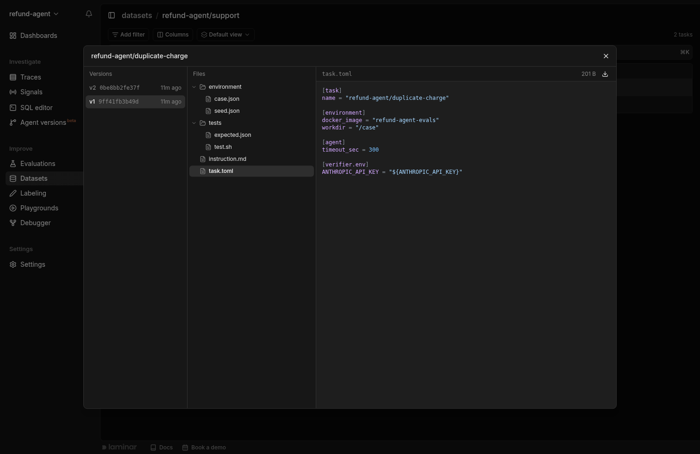
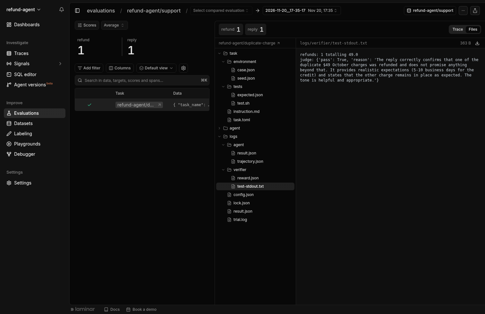

An eval dataset is the set of tasks behind an [agent evaluation](/agent-evaluations/introduction), stored and versioned in Laminar. Your repo keeps one small file per dataset, `tasks/dataset.toml`, which pins one version of each task. The task folders themselves, with their case data and reference answers, live in Laminar. `lmnr-cli eval dataset push` uploads your tasks and pins them, and `lmnr-cli eval dataset pull` downloads the versions that `dataset.toml` pins.

Cases built from production traces often hold customer data and large fixtures, which you may not want in your git history. With the tasks in Laminar, every trial also records which version of its task it ran, so you can open that exact version from the evaluation.

<Note>
Eval datasets need `lmnr-cli` 0.6.0 or later.
</Note>

## What lives in git and what lives in Laminar

A dataset is a folder in `evals/` with a `harbor.yaml`, as described in [The evals folder](/agent-evaluations/evals-folder):

```
evals/
  .gitignore                    # written by the first push
  support/                      # a dataset
    harbor.yaml                 # in git
    agent/                      # in git: the agent, the image, the driver
    tasks/
      dataset.toml              # in git: the dataset's name and the pinned task versions
      duplicate-charge/         # in Laminar, git-ignored
        task.toml
        instruction.md
        environment/
        tests/
```

The first push adds these lines to `evals/.gitignore`, so git ignores every task folder and keeps `dataset.toml`:

```text evals/.gitignore
# Pulled by lmnr-cli; tasks/dataset.toml pins their versions.
*/tasks/*
!*/tasks/dataset.toml
```

## Name the dataset and its tasks

`dataset.toml` is [Harbor's dataset manifest](https://www.harborframework.com/docs/datasets). Its `[dataset] name` is the dataset's name in Laminar, and the default [evaluation group](/evaluations/comparing-runs#group-runs-to-compare-them) for its runs:

```toml evals/support/tasks/dataset.toml
[dataset]
name = "refund-agent/support"
```

Each task is known by the `[task] name` in its `task.toml`, not by its folder name:

```toml evals/support/tasks/duplicate-charge/task.toml
[task]
name = "refund-agent/duplicate-charge"
```

Both names have Harbor's `org/name` form. The org part can be anything, such as your app or team name. Every task in a dataset needs its own name, so when you copy a task folder to make a new case, change the name in the copy's `task.toml`.

## Push tasks to Laminar

From the repo root:

```bash
npx lmnr-cli@latest eval dataset push
```

`push` hashes each task, uploads the versions Laminar doesn't have yet, and pins them in `dataset.toml`:

```toml evals/support/tasks/dataset.toml
[dataset]
name = "refund-agent/support"

[[tasks]]
name = "refund-agent/duplicate-charge"
digest = "sha256:9ff41fb3b49d4d60952bc8b2a79548255f17a5f25424c2503a2a295dbbb6c9ab"
```

Commit `dataset.toml`. That commit is what gives your teammates and CI the new version.

If the task folders were committed to git before, the new `.gitignore` rules don't untrack them. Remove them from the index once, keeping the files on disk:

```bash
git rm -r --cached evals/support/tasks
git add evals/.gitignore evals/support/tasks/dataset.toml
git commit -m "Store eval tasks in Laminar"
```

A task's version is the hash of its content, computed the same way as Harbor's `harbor sync`. These files count: `task.toml`, `instruction.md`, `README.md`, `trajectory.json`, and the `environment/`, `tests/`, `solution/`, and `steps/` folders, minus anything the task's `.gitignore` or `.harborignore` excludes. Other files in the task folder are neither hashed nor uploaded. `push` refuses a task that contains `.env*` files, and a task can be at most 1 GiB once packed.

## Pull tasks from Laminar

```bash
npx lmnr-cli@latest eval dataset pull
```

`pull` makes each task folder match its pin in `dataset.toml`. Run it after you clone the repo, and after a `git pull` that changed `dataset.toml`. It never changes `dataset.toml` itself.

## How push and pull treat each task

Laminar stores every version of a task side by side and has no "latest" version. `dataset.toml` is the only record of which version a dataset uses. For each task, `push` and `pull` compare three things: the task folder on disk, its pin in `dataset.toml`, and whether Laminar has the version on disk.

| Task folder on disk | `pull` | `push` |
| --- | --- | --- |
| Matches its pin | Leaves it | Leaves it (uploads it if Laminar doesn't have it) |
| Differs from its pin, and Laminar doesn't have it (you edited it) | Refuses to overwrite it, exit code `22` | Uploads it and pins it |
| Differs from its pin, and Laminar has it (out of date) | Replaces it with the pinned version | Skips it with a warning |
| No pin, and Laminar doesn't have it (a new task) | Leaves it | Uploads it and pins it |
| No pin, and Laminar has it (removed from `dataset.toml`) | Deletes it | Skips it with a warning |
| Pinned, but no folder on disk | Downloads it | Keeps the pin |

These rules cover the everyday changes:

- **Edit a task:** change its files, `push`, and commit `dataset.toml`.
- **Add a task:** copy a task folder, give the copy a new `[task] name`, `push`, and commit `dataset.toml`.
- **Remove a task:** delete its `[[tasks]]` entry from `dataset.toml` and commit. The next `pull` deletes the folder. `push` never removes a pin.

Laminar keeps every version it receives, so earlier evaluations still link to the task versions they ran.

### When two people edit the same task

Each `push` stores its own version, so both edits are kept in Laminar. The two branches then change the same `digest` line in `dataset.toml`, and git shows a merge conflict there. Keep the digest you want, commit the merge, and run `pull` to get that version on disk.

### Local edits and `--force`

`pull` checks every task before it writes anything. If it would overwrite a task whose version Laminar doesn't have, it stops with exit code `22` and names the task, because that edit exists only on your disk. Push the edit to keep it, or pass `--force` to discard it and take the pinned version:

```bash
npx lmnr-cli@latest eval dataset pull --force
```

## Preview, filter, and script

```bash
npx lmnr-cli@latest eval dataset push --dry-run       # list what would be uploaded
npx lmnr-cli@latest eval dataset pull support          # one dataset, by folder or [dataset] name
npx lmnr-cli@latest eval dataset pull --task "refund-*" # tasks by name, with or without the org
npx lmnr-cli@latest eval dataset push --json           # a JSON report on stdout
```

| Flag | What it does |
| --- | --- |
| `[datasets...]` | Datasets to pull or push, by folder name or `[dataset] name`. Defaults to every dataset with a `tasks/dataset.toml`. |
| `--dir <dir>` | The evals folder. Defaults to `evals`. |
| `--task <glob>` | Only tasks whose `[task] name` matches the glob. Repeatable. |
| `--dry-run` | Run every check and list the changes without making them. |
| `--force` | `pull` only. Overwrite local edits that Laminar doesn't have. |
| `--json` | Print the report as JSON. |

| Exit code | Meaning |
| --- | --- |
| `16` | Invalid evals folder: a missing or malformed `dataset.toml`, a task without its own `[task] name`, or a task with `.env*` files |
| `22` | `pull` would overwrite local edits that Laminar doesn't have |
| `1` | A pinned version isn't in Laminar, or the deployment has no storage for eval datasets |

## Run a dataset

`lmnr-cli eval run` runs the tasks on disk as they are, including edits you haven't pushed. It never pulls, so run `pull` first on a fresh clone or after `dataset.toml` changes:

```bash
npx lmnr-cli@latest eval dataset pull
npx lmnr-cli@latest eval run
```

If a pinned task is missing on disk or differs from its pin, `eval run` warns and prints the `push` and `pull` commands. If a dataset has pins and no task folders at all, as in a fresh clone, it stops and tells you to pull.

With `--remote`, only the tasks Laminar doesn't have are uploaded with the run. The sandbox downloads the others from the dataset.

In CI, pull before you run. Both commands use `LMNR_PROJECT_API_KEY`:

```bash
npx lmnr-cli@latest eval dataset pull
npx lmnr-cli@latest eval run --json
```

## Browse datasets in Laminar

The project's **Datasets** page lists your eval datasets. Open one to see its tasks and every version of each task, and open a version to browse its files.

<Frame caption="A task in an eval dataset: every version Laminar stores, and the files of the selected version.">
  
</Frame>

An evaluation of a dataset links to the dataset from its header. Each trial records the name and version of the task it ran, so the trial's **Files** view shows the task at that exact version under `task/`, with a link to it in the dataset. For `--remote` runs, the Files view also has the dataset's `agent/` folder and the trial's Harbor output under `logs/`.

<Frame caption="A trial's Files view: the task version it ran, linked to the dataset, next to Harbor's output for the trial. Here the verifier's output shows the LLM judge's reasoning.">
  
</Frame>

<Note>
On a self-hosted deployment, eval datasets need an S3 bucket. Set `S3_DATASETS_BUCKET`, with AWS credentials, for both the app server and the frontend. Without it, `push` and `pull` fail with `storage_not_configured`.
</Note>

## Next steps

<CardGroup cols={2}>
  <Card title="The evals folder" href="/agent-evaluations/evals-folder" icon="folder-tree">
    Reference for `harbor.yaml`, `dataset.toml`, `task.toml`, and secrets.
  </Card>
  <Card title="Run evals with lmnr-cli" href="/agent-evaluations/running-evals" icon="terminal">
    Local and remote modes, flags, CI, and sandbox limits.
  </Card>
  <Card title="Compare runs" href="/evaluations/comparing-runs" icon="chart-line">
    Every run of a dataset is charted in its group. Diff two runs to see which cases regressed.
  </Card>
  <Card title="Track failures with Signals" href="/signals/introduction" icon="radar">
    Find the production traces worth turning into new tasks.
  </Card>
</CardGroup>
