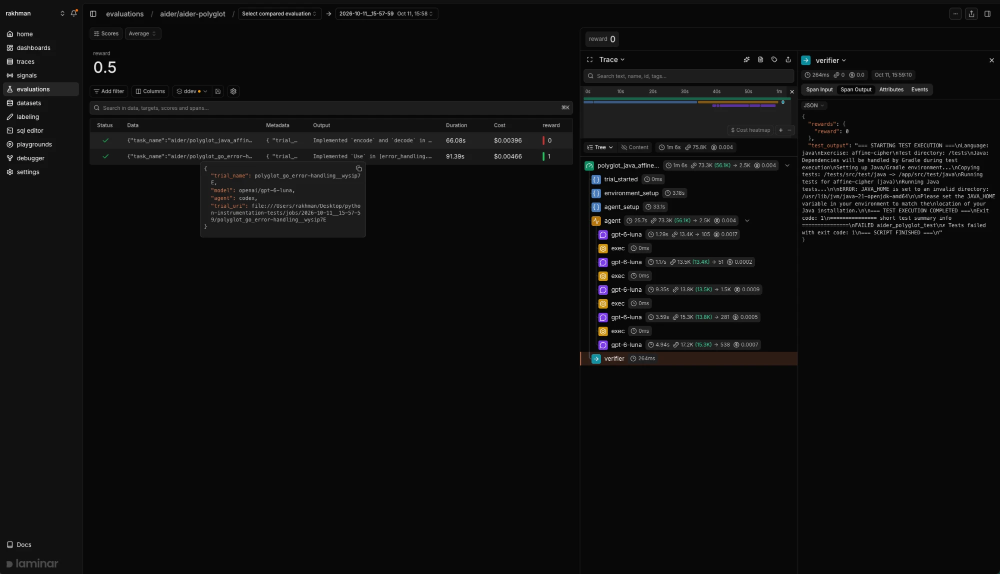

Agent evaluations test your agent end to end, the way it runs in production. Every eval case gets its own isolated container: your real application, its real services (database, queue, cache), and the data that reproduces one specific scenario. A driver calls the app through an entry point it already has, and a verifier scores what the agent left behind. **You run them with [`lmnr-cli eval run`](/agent-evaluations/running-evals), locally on Docker or in Laminar's cloud sandboxes, and every trial lands in Laminar with its score next to the agent's [full trace](/platform/viewing-traces).**

<Note>
Agent evaluations are in beta. The `lmnr-cli eval run` command, its flags, and the folder layout may still change.
</Note>

<Frame caption="A trial in Laminar: the score, the agent's model calls and commands, and the verifier output explaining the failure.">

</Frame>

## Agent evaluations and LLM evaluations

Laminar has two ways to evaluate, named after what they look at:

- **Agent evaluations** (this section) set up a working environment for the agent, let it run, and score the whole outcome, including the state changes, and the agent trajectory.
- **[LLM evaluations](/evaluations/introduction)** call a function in your process with `evaluate()`, then compare its output to target data with evaluator functions.

You can evaluate an agent with LLM evaluations, and for a prompt, a classifier, or a short pipeline that's often the fastest option. Once the agent is large, uses tools, and acts on real systems, the answer to *did it do the right thing* lives in the environment and in the trace, not in a single return value. That's where agent evaluations fit.

| | LLM evaluations | Agent evaluations |
| --- | --- | --- |
| Unit under test | A function in your process | Your app and its services in a container |
| Case data | `data` / `target` on a datapoint | Per-case files seeded into the environment |
| Scoring | Evaluator functions on the output | A verifier script over the resulting state and artifacts |
| Runs on | Your machine or CI | Local Docker, or Laminar sandboxes with `--remote` |
| Best for | Prompts, single LLM calls, pipelines you can call directly | Agents with tools, multi-service apps, replaying production failures |

The two coexist in the same project and share the same evaluation views, [run comparison](/evaluations/comparing-runs), and SQL access.

## Why evaluate the agent in its environment

Unit-style evals become hard once the thing you're testing is an agent that acts on the world:

- **The outcome is not just the final message.** Agent may issue refunds, write database rows, and affect the world around them. Scoring just the final message misses whether the right thing actually happened, and more importantly whether bugs not happened.
- **The bugs are in the integration.** Queries time out; downstream services may experience transient issues; agents may or may not self-heal. Fixtures hide these kinds of issues.
- **Production failures need their exact context.** Reproducing a failure means the same conversation, records, and account state. Each case needs its own data, and cases can't share a database without interfering with each other.

Agent evaluations answer all three by giving every case a fresh, complete copy of the stack:

- **Production fidelity.** The real code and the real services run in the container, started the way production starts them. You seed them and mock them only if absolutely necessary.
- **Isolation.** Each case boots its own stack with its own data, so cases run in parallel with no shared state and no ordering.
- **No or minimal production changes.** The driver calls an entry point the app already has (an HTTP route, a CLI command, a queue message, an exported function), so you test the code path users hit.
- **Local and cloud from one folder.** `lmnr-cli eval run` runs trials on your Docker. Add `--remote` and the same folder runs in Laminar sandboxes, one per trial.
- **No lock-in.** The case format is [Harbor](https://www.harborframework.com)'s, so tasks, image, agent, and verifier are plain Harbor. Laminar adds the trajectories, run history, comparisons, SQL access, and managed execution.

## How a run works

You keep an `evals/` folder next to your code. Each case in it is a Harbor task: which image to start, the data for this scenario, and a verifier. When you run `lmnr-cli eval run`, Laminar:

1. Builds your image from the live source tree.
2. Starts one container per trial, uploads the case's data, and runs the driver against your app.
3. Runs the verifier over what the app produced and records its reward as the score.
4. Attaches the app's LLM and tool calls to the trial's trace, so a failing score takes one click to explain.

Every run of a suite is charted in one evaluation group, local and remote together, so a regression shows up the moment the run lands. [Concepts](/agent-evaluations/concepts) maps each piece to what you see in Laminar.

## Next steps

<CardGroup cols={2}>
  <Card title="Quickstart" href="/agent-evaluations/quickstart" icon="play">
    Have your coding agent set it up, or build a two-case suite by hand.
  </Card>
  <Card title="Concepts" href="/agent-evaluations/concepts" icon="boxes">
    Tasks, environments, agents, verifiers, and trials, and how they map to Laminar.
  </Card>
  <Card title="Build a production harness" href="/agent-evaluations/production-harness" icon="server">
    Run the real services, seed realistic data, and keep the eval honest.
  </Card>
  <Card title="Turn production failures into cases" href="/agent-evaluations/production-failures" icon="radar">
    Close the loop between what breaks in production and what you test.
  </Card>
</CardGroup>
