The [quickstart](/agent-evaluations/quickstart)'s app is one module and a SQLite file. Real products have a database, a queue, background workers, and an LLM configured somewhere. This page covers how to run that whole stack inside a trial, so the [agent evaluation](/agent-evaluations/introduction) measures what your agent does in production. It then covers the two pieces of your code that run on top of the stack in every trial: the driver that calls your app, and the verifier that grades what it produced.

## Guidelines

- **Run the real code and the real services.** Seed them with data instead of mocking them. If something can't run in a container, such as a third-party SaaS, mock it at the network edge through the app's existing base-URL setting, and keep a list of what you mocked, because each mock is something the eval doesn't measure.
- **Drive an entry point the app already has**: a route, a CLI command, a queue consumer, or a function. If you add a code path just for evals, you end up testing that path. When nothing existing reaches the behavior you want, adding an entry point is fine, but make it a deliberate choice, for example an internal endpoint that is off unless a config flag is set.
- **Give every case its own environment.** Each trial boots its own services with its own data, so try to avoid sharing a database between cases.
- **Use the real model.** A canned or recorded response only tests the harness. Point the app at the model through its normal configuration and pass the API key through the agent's env.

## Run the services in the container

Everything the entry point touches runs inside the one container, with no docker-in-docker. Install the same database versions as production, start them as background processes, and create the schema the way the app does at startup. Run the app as its production artifact. A compiled binary should be built in a builder stage of the same Dockerfile, because one built on your Mac is the wrong format.

Harbor starts the container with its own keep-alive command, so the image's `CMD` and entrypoint never run. Put the startup in a script that your agent calls, which launches each service in the background, sends its output to `/logs/agent/`, and waits until the app is ready:

```bash evals/image/shared/start_stack.sh
#!/bin/bash
pg_ctlcluster 17 main start >> /logs/agent/postgres.log 2>&1
/srv/app/migrate.sh >> /logs/agent/migrate.log 2>&1

nohup env -i PATH="$PATH" DATABASE_URL="$DATABASE_URL" ANTHROPIC_API_KEY="$ANTHROPIC_API_KEY" \
  LMNR_TRAJECTORY_PATH="$LMNR_TRAJECTORY_PATH" \
  /srv/app/server >> /logs/agent/app.log 2>&1 &

for i in $(seq 1 60); do
  curl -sf localhost:8080/health && exit 0
  sleep 1
done
tail -n 50 /logs/agent/app.log >&2
exit 1
```

<Tip>
Redirect the output of every background process. A background process that still holds the exec call's output can keep the call from returning. If you start the app with `env -i`, as above, pass in every variable it needs, including `LMNR_TRAJECTORY_PATH` (see [Capture the trajectory](/agent-evaluations/trajectories)).
</Tip>

No ports are published to the host. The driver calls the app from inside the container, which is why the Harbor agent runs there too.

## Seed the data

Some data is the same for every case, such as reference tables, a default organization and user, and config rows. Seed that in the image build or at startup. Data that reproduces one scenario, such as the conversation or the account state, goes in the task's `environment/` folder and is loaded by one shared seed script, so adding a case means copying a directory and never changing the harness.

<Warning>
The agent can read everything in a task's `environment/` folder. Keep reference answers in `tests/`, which Harbor only uploads when the verifier runs. An answer placed in `environment/` can end up in the agent's context, making the evaluation useless.
</Warning>

When creating a record involves encryption or validation, seed it through the app's own API and let the server do the work. For bulk fixtures, insert into the database directly.

<Tip>
Capable models can tell when they are being tested, and an agent that suspects it may behave differently from production. Make seed data look real. Shift timestamps so the latest event is close to now, generate ids the way the app does, use plausible names instead of `John Doe`, and keep harness files out of anything the agent can see (no `/eval` directory or `EVAL_MODE=1`).
</Tip>

## Drive the entry point

The Harbor agent is a small `BaseInstalledAgent` subclass that runs commands inside the container, next to your app. The example's [`agent.py`](https://github.com/lmnr-ai/lmnr-python/blob/main/examples/agent-evals/evals/support/agent/agent.py) is a complete one, and Harbor's [custom agents](https://docs.harborframework.com/agents/custom-agents) guide documents the full interface (`lmnr-cli` pins Harbor 0.25.0). Keep its `run()` thin: start the stack, seed the case, and call the driver. A few things to know:

- **Leave `install()` empty** and put dependencies in the image. `install()` runs in every trial.
- **Read the model from `self.model_name`**, so `--model` works.
- **Only import `harbor`, the standard library, and modules in the suite directory.** The class itself runs in the Harbor process, on your machine or in Laminar's orchestrator, and not inside the container.

The driver is the script the agent runs inside the container, like the example's [`run_case.py`](https://github.com/lmnr-ai/lmnr-python/blob/main/examples/agent-evals/evals/image/shared/run_case.py). It triggers your entry point and waits for the result. For a synchronous entry point, such as an HTTP call or a function that returns, call it with a timeout and record the response. For an asynchronous one, such as a job on a queue, poll the status the app writes until it reaches a final state, up to a hard timeout.

Turn the result into an outcome the verifier can grade, and write the details to `/logs/agent/result.json`. Use `failed` and `timeout` as their own outcomes, so a crash is never mistaken for a wrong answer from the model:

```python
try:
    result = {"outcome": "completed", "reply": handle_ticket(case["ticket"])}
except TimeoutError:
    result = {"outcome": "timeout"}
except Exception as e:
    result = {"outcome": "failed", "error": repr(e)}
```

The driver should exit with `0` whenever it produced an outcome, including `failed` and `timeout`. A non-zero exit marks the trial as an error, which should mean the harness itself broke. Keep the driver's timeout shorter than the exec `timeout_sec`, and both shorter than the task's `[agent] timeout_sec`.

## Grade the result

`tests/test.sh` is the verifier's entry point, and it can call anything: a Python script that compares against `expected.json`, a rubric, or an LLM judge with its key in `[verifier.env]`. It writes the reward to `/logs/verifier/reward.txt`, or to `/logs/verifier/reward.json` to report several named rewards, which become separate scores in Laminar. A pass or fail check is the easiest place to start, and an LLM judge works well for things like the tone or completeness of a reply. Where possible, pair the judge with a hard check on the state the agent changed, as the example's [`verify.py`](https://github.com/lmnr-ai/lmnr-python/blob/main/examples/agent-evals/evals/support/tasks/duplicate-charge/tests/verify.py) does.

Where the verifier runs is set by `environment_mode` under `[verifier]` in `task.toml`:

<Frame caption="A shared verifier runs in the agent's container and sees everything. A separate verifier gets a fresh container with only the files the task hands over.">
  
</Frame>

- **`"shared"`** (the default) runs in the agent's container after the agent finishes, and can read anything the run left behind, such as `/logs/agent/result.json` or the database.
- **`"separate"`** runs in a fresh container that only sees what the task declares: files listed in the top-level `artifacts = [...]`, plus snapshots taken by `[[verifier.collect]]` commands before the environment is torn down. Use it when the verifier needs its own dependencies, or when it shouldn't be able to see the app's internals.

## Next steps

<CardGroup cols={2}>
  <Card title="Capture the trajectory" href="/agent-evaluations/trajectories" icon="route">
    Get the app's LLM and tool calls into every trial's trace.
  </Card>
  <Card title="Track failures with Signals" href="/signals/introduction" icon="radar">
    Find production traces worth turning into cases.
  </Card>
  <Card title="The evals folder" href="/agent-evaluations/evals-folder" icon="folder-tree">
    Reference for `lmnr.yaml`, `harbor.yaml`, `task.toml`, and secrets.
  </Card>
  <Card title="Troubleshooting" href="/agent-evaluations/troubleshooting" icon="life-buoy">
    Fixes for stale images, missing env vars, and empty traces.
  </Card>
</CardGroup>
