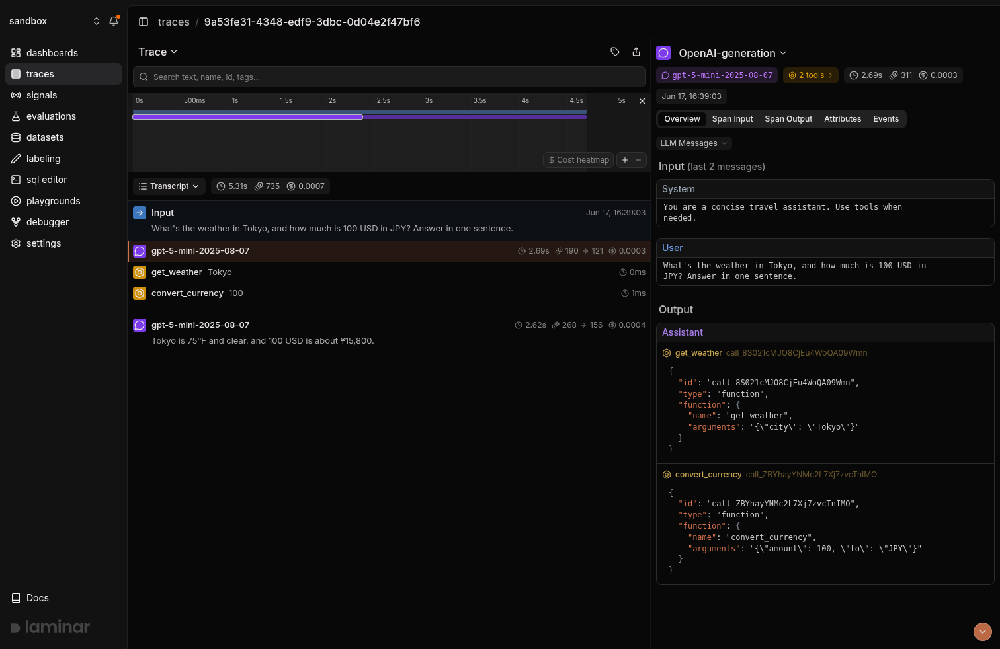

## Overview

Laminar is an open-source, OpenTelemetry-native observability platform for AI agents. If you already trace your agent with Langfuse, the Laminar Langfuse bridge sends the same traces to Laminar with one option on `Laminar.initialize()`, so you can compare both tools on your own runs before deciding anything:

- **No code changes.** Your `observe` functions, Langfuse OpenAI wrappers, and LangChain callback handlers stay as they are.
- **Langfuse is unaffected.** Langfuse receives exactly the spans and attributes it received before. Laminar works on its own copy of each span.
- **Reversible.** Remove the option and Laminar stops receiving the traces.

[Langfuse](https://langfuse.com) is an LLM observability platform whose current SDKs are built on OpenTelemetry. The bridge picks up every span the Langfuse SDK exports and translates it into Laminar's conventions:

- Every Langfuse observation: `observe` functions, manual spans and generations, the OpenAI wrapper, and the LangChain callback handler.
- LLM calls with prompts, responses, tool definitions, tool calls, model, token counts, and cost, in Laminar's message format so they render in the transcript view.
- Tool observations as tool spans, and failed observations as errors.
- Session id, user id, tags, and trace metadata, mapped onto the Laminar trace.
- Correct nesting when Laminar spans and Langfuse spans call each other.

<Note>
Supported versions: Python `langfuse` 3.x, 4.x, and 5.x with `lmnr` 0.9.0 or later, and the TypeScript `@langfuse/*` packages 4.x, 5.x, and 6.x with `@lmnr-ai/lmnr` 0.9.1 or later. The legacy `langfuse` npm package and Python `langfuse` 2.x are not OpenTelemetry-based and are not supported.
</Note>

<Tip>
**Tracing the Vercel AI SDK with Langfuse?** The bridge doesn't forward AI SDK calls. Add [Laminar's AI SDK integration](/integrations/vercel-ai-sdk) next to your Langfuse setup instead, as shown in [Vercel AI SDK](#vercel-ai-sdk-typescript) below.
</Tip>

## Getting started

<Tabs>
<Tab title="TypeScript">

<Steps>
<Step title="Install">

You already have the Langfuse packages and an OpenTelemetry setup with `LangfuseSpanProcessor`. Add Laminar:

```bash
npm install "@lmnr-ai/lmnr@>=0.9.1"
```

</Step>
<Step title="Set environment variables">

Keep your Langfuse keys as they are and add your Laminar project API key:

```bash
export LMNR_PROJECT_API_KEY=your-laminar-project-api-key

# Your existing Langfuse credentials stay untouched.
export LANGFUSE_PUBLIC_KEY=pk-lf-...
export LANGFUSE_SECRET_KEY=sk-lf-...
```

</Step>
<Step title="Initialize Laminar with the Langfuse bridge">

Call `Laminar.initialize()` with `bridges: ["langfuse"]` after your existing OpenTelemetry setup starts:

```typescript {3,9}
import { NodeSDK } from "@opentelemetry/sdk-node";
import { LangfuseSpanProcessor } from "@langfuse/otel";
import { Laminar } from "@lmnr-ai/lmnr";

// Your existing Langfuse setup, unchanged.
const sdk = new NodeSDK({ spanProcessors: [new LangfuseSpanProcessor()] });
sdk.start();

Laminar.initialize({ bridges: ["langfuse"] });
```

Calling `Laminar.initialize()` before `sdk.start()` works too, but OpenTelemetry then logs a harmless `Attempted duplicate registration of API: context` error.

</Step>
<Step title="Run your agent as usual">

Your Langfuse-instrumented code keeps reporting to Langfuse, and the same traces now also land in Laminar:

```typescript
import { observe } from "@langfuse/tracing";
import { observeOpenAI } from "@langfuse/openai";
import OpenAI from "openai";

const client = observeOpenAI(new OpenAI());

const agent = observe(
  async (question: string) => {
    const response = await client.chat.completions.create({
      model: "gpt-5-mini",
      messages: [{ role: "user", content: question }],
    });
    return response.choices[0].message.content;
  },
  { name: "agent" },
);

console.log(await agent("What's the capital of France?"));
```

</Step>
<Step title="Flush Laminar before your script exits">

Laminar sends spans in batches in the background, so a long-running server needs nothing extra. A script, CLI, or serverless function that exits right after the agent finishes must flush Laminar first. `sdk.shutdown()` flushes only your OpenTelemetry setup, which exports to Langfuse. Laminar has its own exporter.

```typescript {2}
// At the end of your script:
await Laminar.shutdown();
await sdk.shutdown();
```

If the process keeps running after this point, for example between serverless invocations, call `await Laminar.flush()` instead: it sends pending spans and keeps Laminar running.

</Step>
</Steps>

</Tab>
<Tab title="Python">

<Steps>
<Step title="Install">

You already have `langfuse` in your project. Add `lmnr` alongside it:

```bash
pip install -U "lmnr>=0.9.0"
```

</Step>
<Step title="Set environment variables">

Keep your Langfuse keys as they are and add your Laminar project API key:

```bash
export LMNR_PROJECT_API_KEY=your-laminar-project-api-key

# Your existing Langfuse credentials stay untouched.
export LANGFUSE_PUBLIC_KEY=pk-lf-...
export LANGFUSE_SECRET_KEY=sk-lf-...
```

</Step>
<Step title="Initialize Laminar with the Langfuse bridge">

Call `Laminar.initialize()` with `bridges=["langfuse"]`. It works whether the Langfuse client is created before or after this call:

```python {1,3}
from lmnr import Laminar

Laminar.initialize(bridges=["langfuse"])

from langfuse import observe
from langfuse.openai import OpenAI

client = OpenAI()
```

</Step>
<Step title="Run your agent as usual">

Your Langfuse-instrumented agent keeps reporting to Langfuse, and the same traces now also land in Laminar.

```python
import json

TOOLS = [
    {
        "type": "function",
        "function": {
            "name": "get_weather",
            "description": "Get the current weather for a city.",
            "parameters": {
                "type": "object",
                "properties": {"city": {"type": "string"}},
                "required": ["city"],
            },
        },
    },
    {
        "type": "function",
        "function": {
            "name": "convert_currency",
            "description": "Convert an amount of USD to another currency.",
            "parameters": {
                "type": "object",
                "properties": {
                    "amount": {"type": "number"},
                    "to": {"type": "string"},
                },
                "required": ["amount", "to"],
            },
        },
    },
]


@observe(as_type="tool")
def get_weather(city: str) -> str:
    return {"Tokyo": "75F, clear", "Paris": "59F, rain"}.get(city, "unknown")


@observe(as_type="tool")
def convert_currency(amount: float, to: str) -> str:
    rates = {"EUR": 0.92, "JPY": 158.0, "GBP": 0.79}
    return f"{amount * rates.get(to, 1.0):.2f} {to}"


DISPATCH = {"get_weather": get_weather, "convert_currency": convert_currency}


@observe()
def agent(question: str) -> str:
    messages = [
        {"role": "system", "content": "You are a concise travel assistant. Use tools when needed."},
        {"role": "user", "content": question},
    ]

    for _ in range(4):
        response = client.chat.completions.create(
            model="gpt-5-mini",
            messages=messages,
            tools=TOOLS,
        )
        msg = response.choices[0].message
        messages.append(msg)

        if not msg.tool_calls:
            return msg.content

        for call in msg.tool_calls:
            args = json.loads(call.function.arguments)
            result = DISPATCH[call.function.name](**args)
            messages.append(
                {"role": "tool", "tool_call_id": call.id, "content": str(result)}
            )

    return "stopped"


print(agent("What's the weather in Tokyo, and how much is 100 USD in JPY?"))
```

</Step>
</Steps>

</Tab>
</Tabs>

### What the `bridges` option changes in Laminar

- **Laminar's own LLM instrumentations are turned off**, so a call that Langfuse already records isn't recorded a second time. Instrumentations that Langfuse doesn't cover stay on, for example the Claude Agent SDK and browser session recording. If you pass an explicit `instruments` (Python) or `instrumentModules` (TypeScript), Laminar uses exactly what you list and logs a warning about any overlap with the bridge.
- **Laminar spans nest under Langfuse spans.** Code you trace with Laminar's own `observe` inside a Langfuse-observed function appears as a child of that function in Laminar, and Langfuse spans inside a Laminar `observe` appear under it.
- **In Python, Laminar keeps its tracer provider separate from Langfuse's**, so Langfuse builds its OpenTelemetry setup exactly as it would without Laminar.

## Vercel AI SDK (TypeScript)

The bridge forwards spans that the Langfuse SDK creates: `observe`, `startActiveObservation`, the OpenAI wrapper, and the LangChain callback handler. The Vercel AI SDK reports to Langfuse through its own OpenTelemetry telemetry, so the bridge doesn't see those calls. To get AI SDK calls into Laminar, add [Laminar's AI SDK integration](/integrations/vercel-ai-sdk) next to your Langfuse setup.

If the AI SDK is all you trace with Langfuse, you don't need the `bridges` option. If you also use the Langfuse SDK, for example `observe` around your agent, you can use both: the bridge forwards the Langfuse spans, and AI SDK calls nest under them in Laminar.

<Tabs>
<Tab title="AI SDK v7">

Register Laminar's telemetry next to Langfuse's. The AI SDK calls every registered integration, so each call reaches both Langfuse and Laminar:

```typescript {4,12}
import { NodeSDK } from "@opentelemetry/sdk-node";
import { LangfuseSpanProcessor } from "@langfuse/otel";
import { LangfuseVercelAiSdkIntegration } from "@langfuse/vercel-ai-sdk";
import { LaminarAiSdkTelemetry } from "@lmnr-ai/lmnr";
import { registerTelemetry } from "ai";

// Your existing Langfuse setup, unchanged.
const sdk = new NodeSDK({ spanProcessors: [new LangfuseSpanProcessor()] });
sdk.start();
registerTelemetry(new LangfuseVercelAiSdkIntegration());

registerTelemetry(new LaminarAiSdkTelemetry());
```

Your `generateText` and `streamText` calls stay as they are. `LaminarAiSdkTelemetry` initializes Laminar for you. To also bridge Langfuse SDK spans, call `Laminar.initialize({ bridges: ["langfuse"] })` before it.

A script that exits right after the agent finishes still needs `await Laminar.shutdown()` before `sdk.shutdown()`, as in [the setup above](#getting-started).

</Tab>
<Tab title="AI SDK v5 and v6">

On v5 and v6, each call sends its spans to a single tracer. With Langfuse, that's the global tracer (`experimental_telemetry: { isEnabled: true }`). Add Laminar's span processor to the same OpenTelemetry setup, so those spans go to both Langfuse and Laminar:

```typescript {3,8}
import { NodeSDK } from "@opentelemetry/sdk-node";
import { LangfuseSpanProcessor } from "@langfuse/otel";
import { LaminarSpanProcessor } from "@lmnr-ai/lmnr";

const sdk = new NodeSDK({
  spanProcessors: [
    new LangfuseSpanProcessor(),
    new LaminarSpanProcessor(),
  ],
});
sdk.start();
```

Keep `experimental_telemetry: { isEnabled: true }` on your calls. `LaminarSpanProcessor` reads `LMNR_PROJECT_API_KEY` from the environment, and `sdk.shutdown()` flushes it along with Langfuse's processor.

This setup has two side effects:

- Laminar's processor receives every span on this provider, including the Langfuse SDK's own observations, which arrive without the bridge's translation. Don't add `bridges: ["langfuse"]` here, or those observations reach Laminar twice.
- Langfuse's copy of each span carries a few extra `lmnr.span.*` attributes that Laminar's processor adds.

On AI SDK v7, each backend has its own integration and neither side effect applies.

</Tab>
</Tabs>

## See what happened in a trace

Open a bridged run in Laminar and you land on the transcript view: the user prompt at the top, each model turn as a conversation line, and every tool call inline with its arguments and result. The bridge rewrites Langfuse's observations into Laminar's message format, so an LLM turn with tool calls reads as a conversation rather than a raw attribute blob. The span tree tells you the shape of the run; the transcript tells you what actually happened.

<Frame caption="Transcript view of a Langfuse-instrumented agent bridged into Laminar: the `agent` run, two `gpt-5-mini` turns, and the `get_weather` and `convert_currency` tool calls translated from Langfuse observations.">

</Frame>

More on the trace UX: [Viewing traces](/platform/viewing-traces).

## When you're ready to use Laminar only

The bridge lets you evaluate Laminar without committing up front. Once you decide to use Laminar only, remove the Langfuse-specific code at your own pace:

1. Remove the `bridges` option. Laminar's own instrumentations turn back on, so for the examples above `Laminar.initialize()` with the defaults traces the OpenAI SDK.
2. Replace the Langfuse OpenAI wrapper with the plain OpenAI client, and swap Langfuse's `observe` for [Laminar's own `observe`](/tracing/structure/observe-decorator).
3. Remove the Langfuse client, span processor, and credentials.

Until then, your Langfuse setup keeps working unchanged.

## Track outcomes with Signals

Traces answer *what happened on this run*. **[Signals](/signals/introduction) answer the cross-trace question**: *how often does the agent skip a tool it should have called, when does it loop, which runs end without answering the user*. A Signal pairs a plain-language instruction with a JSON output schema. Laminar runs it live on new traces (Triggers) or backfills it across history (Jobs) and records a structured event every time it matches. From there you [query](/platform/sql-editor), [cluster](/signals/clusters), and [alert](/signals/alerts) on events across every trace. This is a layer Langfuse doesn't have, and it's a good reason to keep the bridged traces flowing while you evaluate.

<Note>
Every new project ships with a **Failure Detector** Signal that categorizes issues on any trace over 1000 tokens. Open it from the Signals sidebar to see events as soon as your bridged traces arrive.
</Note>

## Query across traces

- **[SQL editor](/platform/sql-editor)** for ad-hoc queries across traces, spans, signals, and evals.
- **SQL API** for programmatic access from scripts and pipelines.
- **[CLI](/platform/cli)** (`lmnr-cli sql query`) for terminal-driven queries and piping JSON into shell tools or coding agents.
- **[MCP server](/platform/mcp)** to query Laminar directly from Claude Code, Cursor, or Codex.

## Troubleshooting

<AccordionGroup>
  <Accordion title="I don't see any traces in Laminar">
    - Confirm `LMNR_PROJECT_API_KEY` is set in the same process that runs the agent.
    - The bridge is opt-in. Installing `langfuse` doesn't enable it: pass `bridges=["langfuse"]` (Python) or `bridges: ["langfuse"]` (TypeScript) to `Laminar.initialize()`.
    - Check the supported versions in the note at the top of this page. In Python, Laminar logs a warning when the installed Langfuse SDK is too old for the bridge.
    - In TypeScript, Langfuse only records spans when an OpenTelemetry tracer provider is set up, for example the `NodeSDK` with `LangfuseSpanProcessor` above.
    - In TypeScript, a script that exits right after the agent finishes must flush Laminar first. See the next entry.
  </Accordion>
  <Accordion title="Traces from a short script never reach Laminar (TypeScript)">
    Laminar exports spans in batches in the background, and `sdk.shutdown()` flushes only your OpenTelemetry setup, which exports to Langfuse. If the process exits before Laminar's next batch goes out, those spans are lost, even though Langfuse shows the run. Add this at the end of the script:

    ```typescript
    await Laminar.shutdown();
    await sdk.shutdown();
    ```

    Use `await Laminar.flush()` instead when the process keeps running, for example at the end of each serverless invocation.
  </Accordion>
  <Accordion title="Attempted duplicate registration of API: context (TypeScript)">
    OpenTelemetry logs this error when `Laminar.initialize()` runs before `sdk.start()`: both register a context manager, and the first one stays. It doesn't stop either export. To avoid the message, call `Laminar.initialize()` after `sdk.start()`.
  </Accordion>
  <Accordion title="The same call shows up twice in Laminar">
    The bridge turns off Laminar's overlapping instrumentations only when you don't pass `instruments` (Python) or `instrumentModules` (TypeScript). If you pass them, remove the providers that you call through Langfuse's wrappers.
  </Accordion>
  <Accordion title="AI SDK calls don't appear in Laminar (TypeScript)">
    The bridge forwards spans created through the Langfuse SDK. The AI SDK reports to Langfuse through its own telemetry, so the bridge doesn't see those calls. Add Laminar's AI SDK integration next to your Langfuse setup, as shown in [Vercel AI SDK](#vercel-ai-sdk-typescript).
  </Accordion>
  <Accordion title="LLM inputs and outputs look like raw JSON, not a conversation">
    The bridge translates Langfuse generations into Laminar's message format. If a span still shows a raw blob, it's likely a non-LLM observation, which keeps its raw input and output. Make sure LLM calls go through the Langfuse OpenAI wrapper, the LangChain callback handler, or a generation observation.
  </Accordion>
  <Accordion title="Self-hosting Laminar">
    Set `base_url` and the ports of your instance when initializing. For a local OSS deployment:

    ```python
    Laminar.initialize(
        base_url="http://localhost",
        http_port=8000,
        grpc_port=8001,
        bridges=["langfuse"],
    )
    ```
  </Accordion>
</AccordionGroup>

## What's next

<CardGroup cols={2}>
  <Card title="Viewing traces" href="/platform/viewing-traces">
    Read the transcript view, filter, and search across traces.
  </Card>
  <Card title="Signals" href="/signals/introduction">
    Detect behaviors and failures across every run, then query, cluster, and alert on them.
  </Card>
  <Card title="SQL editor and MCP server" href="/platform/sql-editor">
    Query traces programmatically from the UI, API, or your IDE.
  </Card>
  <Card title="Tracing structure" href="/tracing/structure/observe-decorator">
    Use Laminar's own `observe`, sessions, metadata, and tags once you migrate off Langfuse.
  </Card>
</CardGroup>

## Related integrations

<CardGroup cols={2}>
  <Card title="OpenAI" href="/integrations/openai">
    Drop Langfuse and trace the OpenAI SDK with Laminar's native instrumentor.
  </Card>
  <Card title="Anthropic" href="/integrations/anthropic">
    Trace the Anthropic SDK directly in TypeScript and Python.
  </Card>
  <Card title="LangChain / LangGraph" href="/integrations/langchain">
    Trace LangChain chains and LangGraph graphs.
  </Card>
  <Card title="Pydantic AI" href="/integrations/pydantic-ai">
    Trace Pydantic AI agent runs and typed tool calls.
  </Card>
  <Card title="LiteLLM" href="/integrations/litellm">
    One integration for every model LiteLLM routes to.
  </Card>
  <Card title="All integrations" href="/integrations">
    Browse every provider, framework, coding agent, and browser integration Laminar supports.
  </Card>
</CardGroup>
