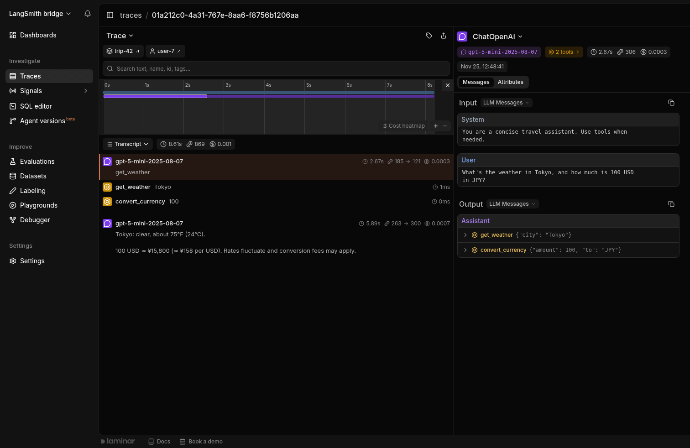

## Overview

Laminar is an open-source, OpenTelemetry-native observability platform for AI agents. If you already trace your agent with LangSmith, the Laminar LangSmith bridge records the same runs in Laminar with one option on `Laminar.initialize()`, so you can compare both tools on your own runs before deciding anything:

- **No code changes.** Your `traceable` functions, LangSmith OpenAI and Anthropic wrappers, and LangChain or LangGraph code stay as they are.
- **LangSmith is unaffected.** LangSmith receives exactly the runs it received before, sent the same way. Laminar reads its own copy of each run inside your process and sends it to Laminar separately.
- **Reversible.** Remove the option and Laminar stops recording the runs.

[LangSmith](https://smith.langchain.com) is LangChain's tracing and evaluation platform. Its SDK sends runs to LangSmith's API instead of using OpenTelemetry. The bridge picks up every run the LangSmith SDK sends and translates it into Laminar spans:

- Every LangSmith run: `traceable` functions, the OpenAI and Anthropic wrappers, LangChain and LangGraph runs, and runs you create with `RunTree`.
- LLM calls with prompts, responses, tool definitions, tool calls, model, token counts, and cost, in Laminar's message format so they render in the transcript view.
- Tool runs as tool spans, and failed runs as errors.
- Session id, user id, tags, and trace metadata, mapped onto the Laminar trace.
- Runs that start inside a Laminar `observe` span nest under it.

<Note>
Supported versions: Python `langsmith` 0.4.15 or later with `lmnr` 0.9.3 or later, and the TypeScript `langsmith` package 0.10 or later with `@lmnr-ai/lmnr` 0.9.7 or later.
</Note>

## Getting started

<Tabs>
<Tab title="TypeScript">

<Steps>
<Step title="Install">

You already have `langsmith` in your project. Add Laminar:

```bash
npm install "@lmnr-ai/lmnr@>=0.9.7"
```

</Step>
<Step title="Set environment variables">

Keep your LangSmith settings as they are and add your Laminar project API key:

```bash
export LMNR_PROJECT_API_KEY=your-laminar-project-api-key

# Your existing LangSmith settings stay untouched.
export LANGSMITH_TRACING=true
export LANGSMITH_API_KEY=lsv2_...
```

</Step>
<Step title="Initialize Laminar with the LangSmith bridge">

Call `Laminar.initialize()` with `bridges: ["langsmith"]` at startup. It works whether LangSmith is imported before or after this call:

```typescript agent.ts {1,6}
import { Laminar } from "@lmnr-ai/lmnr";
import { traceable } from "langsmith/traceable";
import { wrapOpenAI } from "langsmith/wrappers";
import OpenAI from "openai";

Laminar.initialize({ bridges: ["langsmith"] });

const client = wrapOpenAI(new OpenAI());
```

</Step>
<Step title="Run your agent as usual">

Your LangSmith-traced agent keeps reporting to LangSmith, and the same runs now also land in Laminar. The `session_id` and `user_id` metadata become the Laminar session and user:

```typescript agent.ts
const tools: OpenAI.Chat.ChatCompletionTool[] = [
  {
    type: "function",
    function: {
      name: "get_weather",
      description: "Get the current weather for a city.",
      parameters: {
        type: "object",
        properties: { city: { type: "string" } },
        required: ["city"],
      },
    },
  },
  {
    type: "function",
    function: {
      name: "convert_currency",
      description: "Convert an amount of USD to another currency.",
      parameters: {
        type: "object",
        properties: { amount: { type: "number" }, to: { type: "string" } },
        required: ["amount", "to"],
      },
    },
  },
];

const getWeather = traceable(
  async ({ city }: { city: string }) =>
    ({ Tokyo: "75F, clear", Paris: "59F, rain" })[city] ?? "unknown",
  { name: "get_weather", run_type: "tool" },
);

const convertCurrency = traceable(
  async ({ amount, to }: { amount: number; to: string }) => {
    const rates: Record<string, number> = { EUR: 0.92, JPY: 158.0, GBP: 0.79 };
    return `${(amount * (rates[to] ?? 1)).toFixed(2)} ${to}`;
  },
  { name: "convert_currency", run_type: "tool" },
);

const dispatch: Record<string, (args: any) => Promise<string>> = {
  get_weather: getWeather,
  convert_currency: convertCurrency,
};

const agent = traceable(
  async (question: string) => {
    const messages: OpenAI.Chat.ChatCompletionMessageParam[] = [
      { role: "system", content: "You are a concise travel assistant. Use tools when needed." },
      { role: "user", content: question },
    ];

    for (let i = 0; i < 4; i++) {
      const response = await client.chat.completions.create({
        model: "gpt-5-mini",
        messages,
        tools,
      });
      const msg = response.choices[0].message;
      messages.push(msg);

      if (!msg.tool_calls?.length) return msg.content;

      for (const call of msg.tool_calls) {
        if (call.type !== "function") continue;
        const args = JSON.parse(call.function.arguments);
        const result = await dispatch[call.function.name](args);
        messages.push({ role: "tool", tool_call_id: call.id, content: result });
      }
    }
    return "stopped";
  },
  { name: "travel_agent", metadata: { session_id: "trip-42", user_id: "user-7" } },
);

console.log(await agent("What's the weather in Tokyo, and how much is 100 USD in JPY?"));
```

</Step>
<Step title="Flush Laminar before your script exits">

Laminar sends spans in batches in the background, so a long-running server needs nothing extra. A script, CLI, or serverless function that exits right after the agent finishes must flush Laminar first:

```typescript agent.ts {2}
// At the end of your script:
await Laminar.shutdown();
```

If the process keeps running after this point, for example between serverless invocations, call `await Laminar.flush()` instead: it sends pending spans and keeps Laminar running.

</Step>
</Steps>

</Tab>
<Tab title="Python">

<Steps>
<Step title="Install">

You already have `langsmith` in your project. Add `lmnr` alongside it:

```bash
pip install -U "lmnr>=0.9.3"
```

</Step>
<Step title="Set environment variables">

Keep your LangSmith settings as they are and add your Laminar project API key:

```bash
export LMNR_PROJECT_API_KEY=your-laminar-project-api-key

# Your existing LangSmith settings stay untouched.
export LANGSMITH_TRACING=true
export LANGSMITH_API_KEY=lsv2_...
```

</Step>
<Step title="Initialize Laminar with the LangSmith bridge">

Call `Laminar.initialize()` with `bridges=["langsmith"]`. It works whether the LangSmith client is created before or after this call:

```python {1,3}
from lmnr import Laminar

Laminar.initialize(bridges=["langsmith"])

from langsmith import traceable
from langsmith.wrappers import wrap_openai
from openai import OpenAI

client = wrap_openai(OpenAI())
```

</Step>
<Step title="Run your agent as usual">

Your LangSmith-traced agent keeps reporting to LangSmith, and the same runs now also land in Laminar. The `session_id` and `user_id` metadata become the Laminar session and user:

```python
import json

TOOLS = [
    {
        "type": "function",
        "function": {
            "name": "get_weather",
            "description": "Get the current weather for a city.",
            "parameters": {
                "type": "object",
                "properties": {"city": {"type": "string"}},
                "required": ["city"],
            },
        },
    },
    {
        "type": "function",
        "function": {
            "name": "convert_currency",
            "description": "Convert an amount of USD to another currency.",
            "parameters": {
                "type": "object",
                "properties": {
                    "amount": {"type": "number"},
                    "to": {"type": "string"},
                },
                "required": ["amount", "to"],
            },
        },
    },
]


@traceable(run_type="tool")
def get_weather(city: str) -> str:
    return {"Tokyo": "75F, clear", "Paris": "59F, rain"}.get(city, "unknown")


@traceable(run_type="tool")
def convert_currency(amount: float, to: str) -> str:
    rates = {"EUR": 0.92, "JPY": 158.0, "GBP": 0.79}
    return f"{amount * rates.get(to, 1.0):.2f} {to}"


DISPATCH = {"get_weather": get_weather, "convert_currency": convert_currency}


@traceable(name="travel_agent", metadata={"session_id": "trip-42", "user_id": "user-7"})
def agent(question: str) -> str:
    messages = [
        {"role": "system", "content": "You are a concise travel assistant. Use tools when needed."},
        {"role": "user", "content": question},
    ]

    for _ in range(4):
        response = client.chat.completions.create(
            model="gpt-5-mini",
            messages=messages,
            tools=TOOLS,
        )
        msg = response.choices[0].message
        messages.append(msg)

        if not msg.tool_calls:
            return msg.content

        for call in msg.tool_calls:
            args = json.loads(call.function.arguments)
            result = DISPATCH[call.function.name](**args)
            messages.append(
                {"role": "tool", "tool_call_id": call.id, "content": str(result)}
            )

    return "stopped"


print(agent("What's the weather in Tokyo, and how much is 100 USD in JPY?"))
```

</Step>
</Steps>

</Tab>
</Tabs>

### What the `bridges` option changes in Laminar

- **Laminar's own LLM and LangChain instrumentations are turned off**, so a call that LangSmith already records isn't recorded a second time. Instrumentations that LangSmith doesn't cover stay on, for example browser session recording. In Python, the LangGraph instrumentation stays on too and adds the graph's nodes and edges to the trace. If you pass an explicit `instruments` (Python) or `instrumentModules` (TypeScript), Laminar uses exactly what you list and logs a warning about any overlap with the bridge.
- **LangSmith runs nest under Laminar spans.** A `traceable` function or LangGraph run called inside Laminar's own `observe` appears as a child of that span in Laminar.
- **In Python, Laminar keeps its tracer provider separate from the global OpenTelemetry provider**, so LangSmith's optional OpenTelemetry modes keep sending to LangSmith.

### What Laminar records from LangSmith

Laminar records the runs as LangSmith sends them, after LangSmith's own settings are applied:

- **Redaction carries over.** Inputs and outputs that you hide with `hide_inputs` / `hide_outputs` (`hideInputs` / `hideOutputs` in TypeScript), the `LANGSMITH_HIDE_INPUTS` / `LANGSMITH_HIDE_OUTPUTS` variables, or an anonymizer arrive in Laminar hidden the same way.
- **Sampling carries over.** Runs that `LANGSMITH_TRACING_SAMPLING_RATE` drops are not recorded in Laminar either.
- **Tracing must be on.** With `LANGSMITH_TRACING` unset or `false`, LangSmith creates no runs, so Laminar has nothing to record.
- **Attachments are not recorded.** Files attached to a run go to LangSmith only.
- **A run appears in Laminar when it ends.** A run that never finishes, for example because the process exits mid-run, is not recorded.

LangChain and LangGraph runs are recorded the way [Laminar's LangChain integration](/integrations/langchain#what-laminar-records) records them:

- Spans carry the run names you see in LangSmith: the graph, each node, each tool, and each model call.
- LLM spans hold the messages, tool definitions, response, model, token usage, and cost. Tool and retriever spans keep their full input and output.
- Chain and graph node spans don't record the graph state, which repeats on every step. Only a few small keys such as `max_steps` or `token_usage` are kept.
- Internal steps such as `RunnableSequence` and `RunnableLambda` inside a chain get no span of their own: their children appear under the nearest step that has one.
- LangGraph's `thread_id` becomes the Laminar session. In Python, the graph's nodes and edges also power the [LangGraph view](/tracing/langgraph-visualization).
- Metadata you set on the root run becomes trace metadata. The keys that LangSmith, LangChain, and LangGraph add themselves, such as `ls_provider` or `langgraph_node`, are left out.

## See what happened in a trace

Open a bridged run in Laminar and you land on the transcript view: the user prompt at the top, each model turn as a conversation line, and every tool call inline with its arguments and result. The bridge rewrites LangSmith's runs into Laminar's message format, so an LLM turn with tool calls reads as a conversation rather than a raw JSON payload.

<Frame caption="Transcript view of a LangSmith-traced agent bridged into Laminar: the `travel_agent` run with its session and user, two `gpt-5-mini` turns, and the `get_weather` and `convert_currency` tool calls.">

</Frame>

More on the trace UX: [Viewing traces](/platform/viewing-traces).

## When you're ready to use Laminar only

The bridge lets you evaluate Laminar without committing up front. Once you decide to use Laminar only, remove the LangSmith-specific code at your own pace:

1. Remove the `bridges` option. Laminar's own instrumentations turn back on, so `Laminar.initialize()` with the defaults traces the OpenAI SDK and LangChain. See [LangChain and LangGraph](/integrations/langchain) for the TypeScript setup.
2. Replace the LangSmith wrappers with the plain provider clients, and swap `traceable` for [Laminar's own `observe`](/tracing/structure/observe-decorator).
3. Set `LANGSMITH_TRACING=false` or remove your LangSmith settings.

Until then, your LangSmith setup keeps working unchanged.

## Track outcomes with Signals

Traces answer *what happened on this run*. **[Signals](/signals/introduction) answer the cross-trace question**: *how often does the agent skip a tool it should have called, when does it loop, which runs end without answering the user*. A Signal pairs a plain-language instruction with a JSON output schema. Laminar runs it live on new traces (Triggers) or backfills it across history (Jobs) and records a structured event every time it matches. From there you [query](/platform/sql-editor), [cluster](/signals/clusters), and [alert](/signals/alerts) on events across every trace.

<Note>
Every new project ships with an **Issues** Signal that records the errors your agent makes on any trace over 1000 tokens. Open it from the Signals section of the sidebar to see its clusters as soon as your bridged traces arrive.
</Note>

## Query across traces

- **[SQL editor](/platform/sql-editor)** for ad-hoc queries across traces, spans, signals, and evals.
- **SQL API** for programmatic access from scripts and pipelines.
- **[CLI](/platform/cli)** (`lmnr-cli sql query`) for terminal-driven queries and piping JSON into shell tools or coding agents.
- **[MCP server](/platform/mcp)** to query Laminar directly from Claude Code, Cursor, or Codex.

## Troubleshooting

<AccordionGroup>
  <Accordion title="I don't see any traces in Laminar">
    - Confirm `LMNR_PROJECT_API_KEY` is set in the same process that runs the agent.
    - The bridge is opt-in. Installing `langsmith` doesn't enable it: pass `bridges=["langsmith"]` (Python) or `bridges: ["langsmith"]` (TypeScript) to `Laminar.initialize()`.
    - Confirm LangSmith tracing is on (`LANGSMITH_TRACING=true`). Laminar records only the runs LangSmith sends.
    - Check the supported versions in the note at the top of this page. Laminar logs a warning when the installed LangSmith SDK is too old for the bridge.
    - In TypeScript, a script that exits right after the agent finishes must flush Laminar first, as shown in [the setup above](#getting-started).
  </Accordion>
  <Accordion title="Some inputs or outputs are empty in Laminar">
    Laminar records what LangSmith sends, after LangSmith's redaction. If you hide inputs or outputs from LangSmith, they're hidden in Laminar too. Chain and graph node spans from LangChain and LangGraph also leave out the graph state, as described in [What Laminar records from LangSmith](#what-laminar-records-from-langsmith).
  </Accordion>
  <Accordion title="The same call shows up twice in Laminar">
    The bridge turns off Laminar's overlapping instrumentations only when you don't pass `instruments` (Python) or `instrumentModules` (TypeScript). If you pass them, remove the providers that you call through LangSmith's wrappers or LangChain.
  </Accordion>
  <Accordion title="The first run of a script has no input (TypeScript with tsx)">
    When your code runs through tsx, Laminar starts recording the LangSmith runs a few milliseconds after `Laminar.initialize()`. A run that starts in that window, for example an agent a script calls right after initializing, still appears in Laminar, but without its input. Runs that start later, such as every request a server handles, are recorded in full. Running the script with plain `node`, which runs TypeScript files directly on current Node.js versions, avoids the delay.
  </Accordion>
  <Accordion title="Laminar spans inside a LangSmith run appear next to it, not under it">
    Laminar records a LangSmith run when the run ends, so spans that Laminar's own `observe` creates inside a `traceable` function nest under the closest Laminar span instead of under the run. Runs started inside a Laminar span nest correctly.
  </Accordion>
  <Accordion title="Self-hosting Laminar">
    Set `base_url` and the ports of your instance when initializing. For a local OSS deployment:

    ```python
    Laminar.initialize(
        base_url="http://localhost",
        http_port=8000,
        grpc_port=8001,
        bridges=["langsmith"],
    )
    ```
  </Accordion>
</AccordionGroup>

## What's next

<CardGroup cols={2}>
  <Card title="Viewing traces" href="/platform/viewing-traces">
    Read the transcript view, filter, and search across traces.
  </Card>
  <Card title="Signals" href="/signals/introduction">
    Detect behaviors and failures across every run, then query, cluster, and alert on them.
  </Card>
  <Card title="SQL editor and MCP server" href="/platform/sql-editor">
    Query traces programmatically from the UI, API, or your IDE.
  </Card>
  <Card title="Tracing structure" href="/tracing/structure/observe-decorator">
    Use Laminar's own `observe`, sessions, metadata, and tags once you migrate off LangSmith.
  </Card>
</CardGroup>

## Related integrations

<CardGroup cols={2}>
  <Card title="LangChain / LangGraph" href="/integrations/langchain">
    Trace LangChain chains and LangGraph graphs.
  </Card>
  <Card title="deepagents" href="/integrations/deepagents">
    Trace deepagents runs, subagents, and tool calls.
  </Card>
  <Card title="Langfuse" href="/integrations/langfuse">
    Keep Langfuse and send the same spans to Laminar too.
  </Card>
  <Card title="OpenAI" href="/integrations/openai">
    Trace the OpenAI SDK directly in TypeScript and Python.
  </Card>
  <Card title="Anthropic" href="/integrations/anthropic">
    Trace the Anthropic SDK directly in TypeScript and Python.
  </Card>
  <Card title="All integrations" href="/integrations">
    Browse every provider, framework, coding agent, and browser integration Laminar supports.
  </Card>
</CardGroup>
