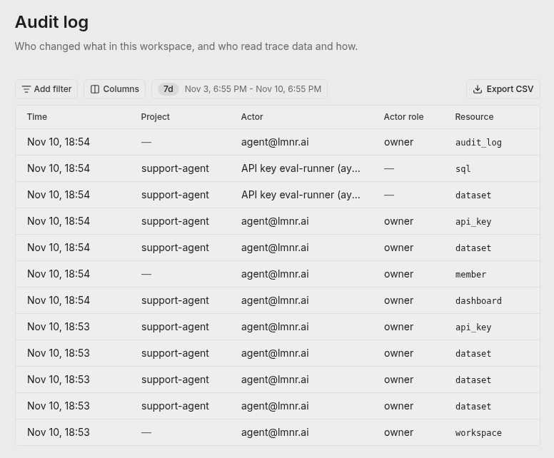
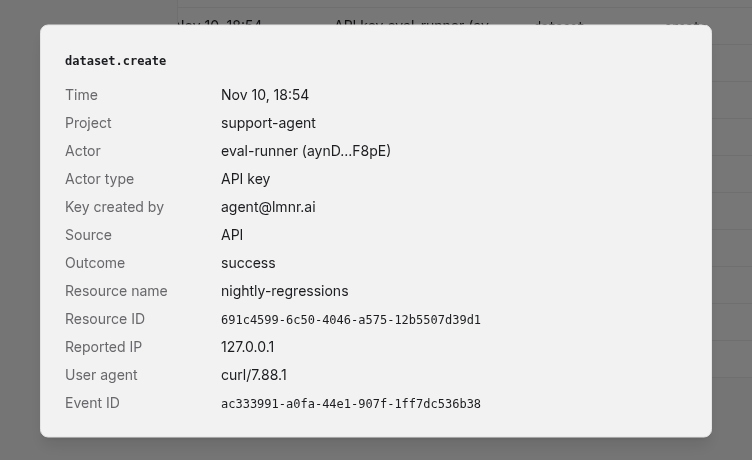

The **audit log** records who changed what in a Laminar workspace, and who read trace data and how. Every event names the person or API key that acted, the resource they acted on, where the request came from (the UI, the API, the CLI, the MCP server, or the Laminar Agent), and whether it succeeded. Use it to answer questions like "who deleted this dataset?", "which API key ran this SQL query?", or "who opened traces in this project last week?".

Open it from **Settings > Audit log**, under **Workspace settings**. The log covers every project in the workspace.

<Frame caption="Settings > Audit log: changes made in the UI and by a project API key, newest first">
  
</Frame>

<Note>
  The audit log is available to workspace owners and admins. On Laminar Cloud, it's included in the Pro and Enterprise plans. Self-hosted deployments have it on every workspace.
</Note>

## Read the log

The table lists events newest first, for the last week by default. Pick a different time range at the top, filter by any column, and use **Columns** to show, hide, or reorder them:

| Column | What it shows |
|---|---|
| **Time** | When the request was made. |
| **Project** | The project the event happened in. Workspace-level events, such as a member being invited, have no project. |
| **Actor** | The user's email, or the API key's name and shortened value. |
| **Actor role** | The user's role in the workspace when they acted: owner, admin, or member. |
| **Resource** and **Action** | What was acted on and how, for example `dataset` / `delete` or `trace` / `view`. |
| **Resource name** and **Resource ID** | The resource the event is about. |
| **Source** | Where the request came from: UI, API, CLI, MCP, or Laminar Agent. |
| **Outcome** | `success`, `denied` (the actor didn't have permission), or `error`. |

Names are captured when the event is recorded, so an event still shows a dataset's or a project's name after it's renamed or deleted.

Click a row to see the full event. Besides the columns above, it shows the reported IP address, the user agent, who created the API key (for events by an API key), and the event's metadata. Metadata holds the details of the action, such as the text and tables of a SQL query, the settings that were changed, or the IDs of every item in a bulk delete.

<Frame caption="An event made with a project API key, with the key's creator, source, and request details">
  
</Frame>

### Export to CSV

Click **Export CSV** to download the events that match the current filters and time range as a CSV file, up to 100,000 rows. Exporting is itself recorded in the log.

## What's recorded

### Changes

Every create, update, and delete made from the UI, the API, the CLI, or the MCP server is recorded, including requests that were denied or failed:

| Area | Examples |
|---|---|
| **Workspace** | Creating, renaming, and deleting a workspace, workspace settings, usage warnings and hard limits, license, billing and plan changes, Slack channel settings and disconnecting Slack, LLM profiles, and Signal report subscriptions. |
| **Members** | Invitations sent and revoked, members joining, role changes, removals, and ownership transfers. |
| **Projects** | Creating, renaming, and deleting projects, project settings, project API keys, custom model costs, render templates, and tag classes. |
| **Project data** | Datasets and datapoints, evaluations, Signals (including triggers and backfills), alerts, dashboards and charts, labeling queues, playgrounds, SQL templates, saved table views, and debugger sessions. Deleting traces, and sharing or unsharing a trace, are recorded too. |

### Reads of trace data

Reads are recorded when they show or export trace data:

- Opening a trace, and loading the traces or sessions table. A table load is one event, however far you scroll.
- SQL queries from the [SQL editor](/platform/sql-editor), dashboards, the SQL API, the CLI, the [MCP server](/platform/mcp), and the [Laminar Agent](/platform/laminar-agent), with the query text and the tables it read.
- Exports: downloading a dataset or an evaluation, and exporting SQL results to a dataset.
- Starting a Laminar Agent chat.
- Viewing the audit log, at most once per hour per user.

## What isn't recorded

- **Trace ingestion.** Sending spans, logs, and browser session recordings from the SDKs isn't recorded. Neither are the individual steps of a run: an evaluation or a debugger session is recorded once, when it starts.
- **Opening or listing other resources**, such as a dataset or the Signals list. Downloading or exporting them is recorded.
- **Queries Laminar runs to show built-in pages**, such as the trace view's own lookups. SQL you write, and dashboard charts, are recorded.
- **Sign-ins and membership sync.** Signing in and out, and members added or removed by SSO or SCIM, aren't recorded yet.
- **Actions in Slack**, such as interacting with an alert message.
- **Requests Laminar can't attribute**, for example a request with an invalid API key, or a request that's rejected before Laminar knows which project it's for.

The audit log isn't available as a SQL table, so it can't be read through the SQL editor, the SQL API, or the MCP server.

## Related

<CardGroup cols={2}>
  <Card title="Projects and API keys" icon="key" href="/projects/introduction#projects-api-keys-and-separation">
    Keys show up in the log by name, with the user who created them.
  </Card>
  <Card title="SQL editor" icon="database" href="/platform/sql-editor">
    Every query you run is recorded with its text and tables.
  </Card>
  <Card title="PII redaction" icon="shield" href="/platform/pii-redaction">
    Control which readers see sensitive span content.
  </Card>
  <Card title="Usage limits" icon="gauge" href="/platform/usage-limits">
    Workspace-level settings whose changes appear in the log.
  </Card>
</CardGroup>
