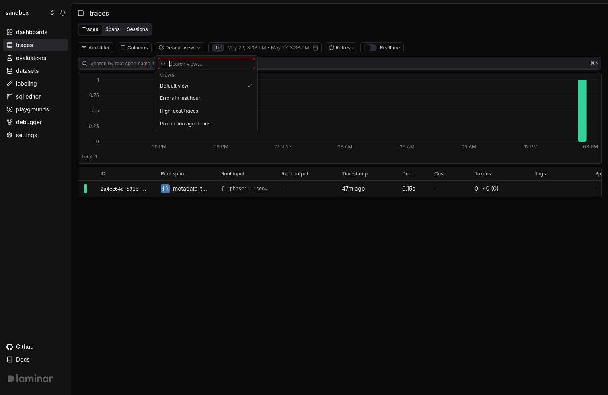
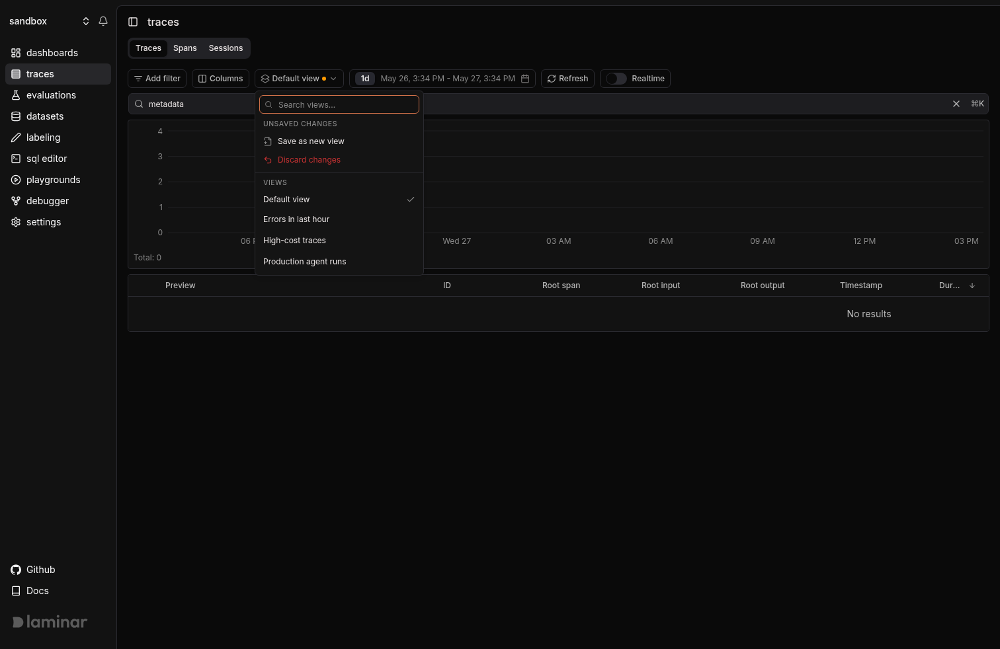
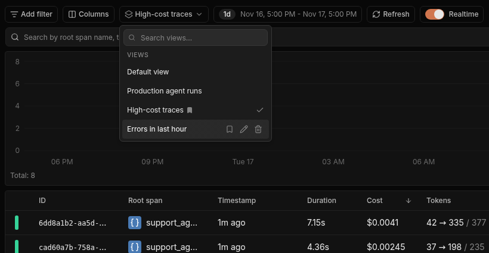
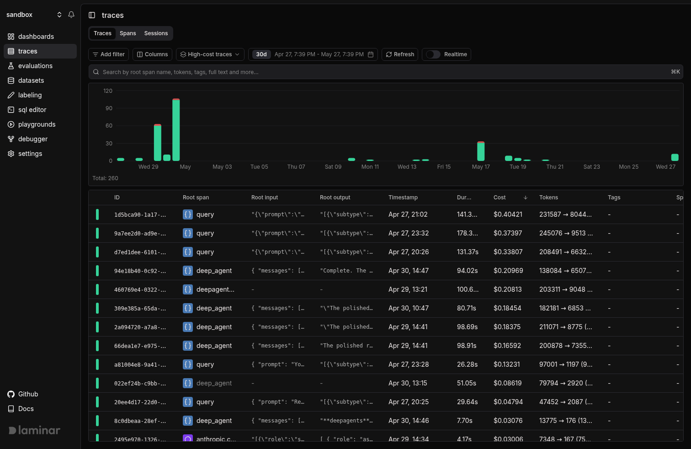

**Table views** save a table's filters, search, sort, and column layout as a named preset you can reopen with one click. Views are stored per project, so any member of the project can pick the same preset from the dropdown.

<Frame caption="The view picker on the traces table, with three saved views.">
  
</Frame>

Each view is scoped to one table (Traces, Spans, Sessions, Evaluations, and the others), so saving a view on Traces never clutters the dropdown on Spans. Each table can also have a [project default view](#set-a-project-default-view): the view teammates land on when they open the table.

## Save a view

Set up the table the way you want it. The picker shows an amber dot when the current state has drifted from any saved view; open it and the **Unsaved changes** section appears:

- **Save changes** writes back to the active view.
- **Save as new view** prompts for a name.
- **Discard changes** reverts to the active view (or to `Default view` if none is loaded).

<Frame caption="The Unsaved changes section appears when the table state has drifted from the active view.">
  
</Frame>

## Set a project default view

A table opens on its built-in **Default view** until you pick a saved view. To have your team land on a saved view instead, make it the **project default view**: open the picker, hover over the view, and click the bookmark icon (**Set as project default view**). A filled bookmark next to a view's name marks the current project default.

<Frame caption="The views picker on the Traces table. The filled bookmark marks High-cost traces as the project default view, and hovering Errors in last hour shows the bookmark that would make it the default.">
  
</Frame>

Each table has its own project default, so the default on Traces doesn't change what Spans or Sessions open on. Any member of the project can change it.

When you open a table, Laminar picks the view in this order:

1. The view in the URL, when you follow a link to a view.
2. The last view you picked on this table in this browser, including **Default view**.
3. The project default view.
4. The built-in **Default view**.

Setting a project default doesn't override a teammate's own choice. Someone who has already picked a view on that table keeps it, and they can pick the project default from the picker like any other view.

Saving changes to the project default view or renaming it keeps it the default. To make the built-in **Default view** the project default again, hover over **Default view** in the picker and click its bookmark. Deleting the project default view has the same effect.

## Example: Most expensive traces

Sort the Traces table by Cost descending, hide the columns you don't need (root output, tags, metadata, session/user id), and save it as **High-cost traces**. Anyone in the project opening the Traces tab can pick that view from the dropdown to land on the same focused table, or you can make it the project default so they land on it without picking.

<Frame caption="The Traces table with the High-cost traces view applied: sorted by cost desc, with low-signal columns hidden.">
  
</Frame>

## Ask Laminar Agent to set up a view

[Laminar Agent](/platform/laminar-agent) can create, change, and delete saved views, and make a view the project default. Describe the view you want:

- "Create a Traces view sorted by cost, showing only ID, input, cost, and duration, and make it the project default."
- "Add a filter for errors to the Production agent runs view."

For most tables, the agent replies with a link that opens the view.

## Query views with SQL

Saved views are queryable in the [SQL editor](/platform/sql-editor#table_views) as the `table_views` table. Each row's `config` holds the view's columns, filters, search, and sort, and its `isDefault` key is `true` on the project default view:

```sql
SELECT resource, name
FROM table_views
WHERE JSONExtractBool(config, 'isDefault')
```

## What's next

<CardGroup cols={2}>
  <Card title="Full text search" icon="search" href="/platform/search">
    Search across span input, output, and attributes; saved into a view alongside your filters.
  </Card>
  <Card title="SQL Editor" icon="database" href="/platform/sql-editor">
    When a view's filters are not enough, drop into raw SQL across traces, spans, signals, and evals.
  </Card>
</CardGroup>
