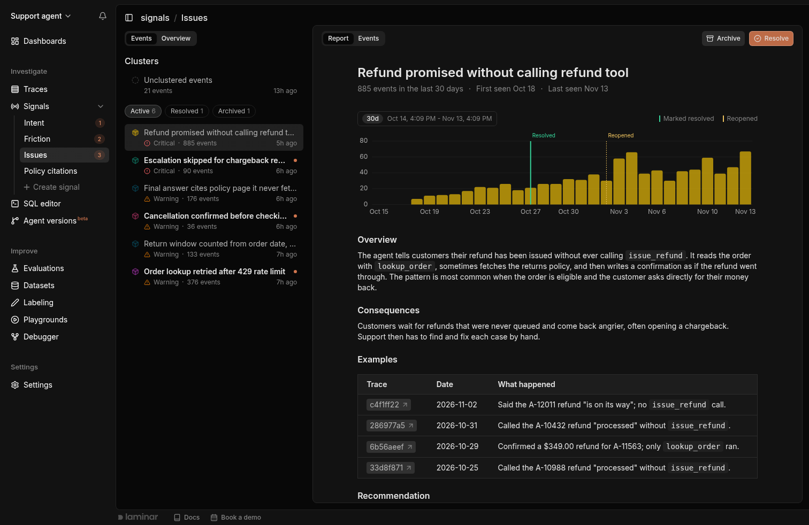
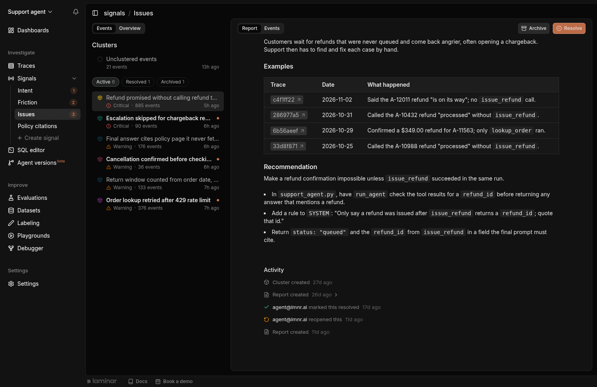
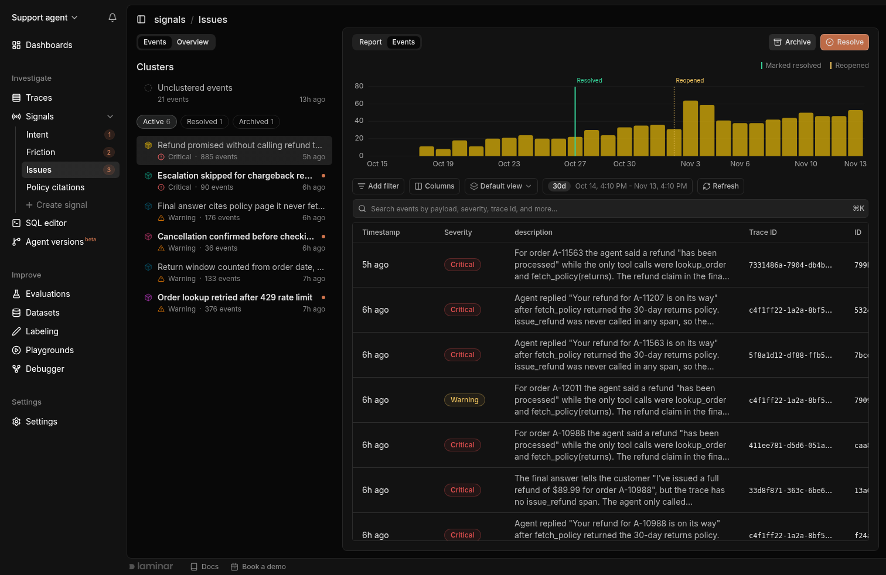
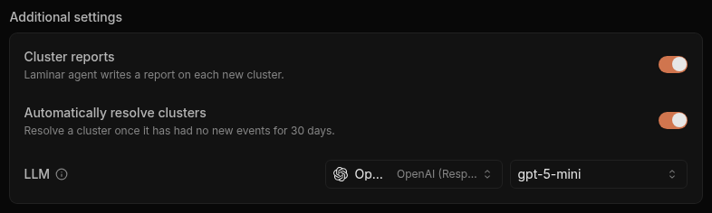

When a Signal has fired across thousands of traces, reading the event list by hand stops working. **Clusters group similar signal events into named problems**, and each cluster gets its own page: how often it happens, an agent-written report on what goes wrong and how to fix it, and the events behind it. Opening a Signal opens its clusters.

<Frame caption="A Signal's Events tab: the cluster list on the left, the selected cluster's report on the right">
  
</Frame>

## What a cluster is

A cluster is a group of signal events whose summaries are semantically similar. Laminar groups events by meaning rather than exact wording, so *"timeout calling the payments API"* and *"payments request exceeded deadline"* land in the same cluster. Clustering is scoped to a single Signal: events from different Signals never share a cluster.

Treat a cluster like an issue in a tracker. It has a name, a severity, a history, and a state: **Active** while it needs attention, **Resolved** once you've fixed it, or **Archived** when you don't want to track it.

<Note>
Clustering is fully automatic. You will start to see clusters as more traces are processed.
</Note>

## Find your clusters

Every Signal in the project is listed under **Signals** in the project sidebar. Click **Signals** to expand the list, then click a Signal to open it. A badge next to each Signal counts the clusters with events you haven't seen yet, and the collapsed **Signals** row shows the total across Signals. When a project has more than four Signals, the last row reads **More** and opens the rest on hover.

A Signal opens on its **Events** tab. The left column lists the Signal's clusters, and the right column shows the selected cluster. The first cluster in the list opens by default.

- **Unclustered events**, pinned at the top, holds the events that haven't joined a named cluster yet. Open it to see their chart and table.
- **Active**, **Resolved**, and **Archived** switch between the three lists, each with its count. Active and Archived are sorted by the most recent event, Resolved by the most recent resolve.
- Each cluster row shows the cluster's severity (the average severity of its events), its total event count, and when its last event arrived.
- A cluster in bold with a dot is **unread**: it has events that arrived after you last opened it. Opening a cluster marks it as read. Read state is per user, so your teammates keep their own.

## The cluster page

The top of the cluster page has two tabs, **Report** and **Events**, and two actions, **Archive** and **Resolve**. If [cluster reports](#cluster-reports) are off for the Signal, there is no Report tab and the cluster opens on its events.

### Report

The Report tab reads top to bottom:

- **Header**: the cluster's name, how many events it had in the selected date range, and when it was first and last seen.
- **Frequency chart**: one bar per day, for the range picked in the date filter above it (the last 30 days by default). Markers show when the cluster was resolved and reopened, and when each version of your agent first appeared among the cluster's traces. Version markers come from [agent versions](/tracing/agent-versions), so a cluster that starts right after a new version marker points at the change that caused it.
- **Report**: the newest [cluster report](#cluster-reports).
- **Activity**: the cluster's history, oldest first. It lists when the cluster was created, every report written on it, and who resolved, reopened, or archived it. Older reports expand in place.

<Frame caption="Further down the Report tab: the report's example traces and recommendation, then the cluster's activity">
  
</Frame>

### Events

The Events tab shows the cluster's frequency chart above a table of its events, one row per event, covering the last 30 days by default. Filter the table by the fields of the Signal's output schema, or search events by payload, severity, trace ID, and more. Click a row to open the trace that produced the event in a side panel.

<Frame caption="A cluster's Events tab: daily event counts above the table of its events">
  
</Frame>

## Cluster reports

When a new cluster forms, [Laminar Agent](/platform/laminar-agent) investigates it and writes a report. The agent reads the cluster's signal events: their payloads, timestamps, and how their count changes over time. It doesn't open the traces themselves, so the report stays grounded in what the Signal recorded. When the agent can read your project's connected code repository, the recommendation names the files and functions to change. Otherwise it recommends from the events alone.

Every report has the same four sections:

- **Overview**: what the problem is, in a few sentences, or as numbered steps when the problem is a sequence.
- **Consequences**: how it affects your users and what it breaks downstream.
- **Examples**: three to five events in a table, each with a link to its trace, its date, and one sentence on what happened.
- **Recommendation**: how to fix it, as a short direction followed by one bullet per change.

Writing a report takes a few minutes. Until it's done, the Report tab says **Writing a report**. If a cluster has no report, for example because it formed before reports were turned on or because the last attempt failed, click **Generate report**. Archived clusters don't get reports.

Reports are controlled per Signal by the **Cluster reports** switch. Find it in the Signal's **Overview** tab, under **Settings > Additional settings**. Reports are on by default for new Signals, except Signals created from the **Intent** template, whose clusters are categories of user intent rather than problems to fix.

<Frame caption="Additional settings in a Signal's Overview tab: cluster reports, automatic resolving, and the Signal's LLM profile">
  
</Frame>

## Resolve, reopen, and archive

Clusters move between the Active, Resolved, and Archived lists as you work on them.

- **Resolve** a cluster once you've shipped a fix. It moves to the Resolved list, and a Resolved marker appears on its chart. Events can still join a resolved cluster, and they mark it unread, so you'll notice if the fix didn't hold. Click **Reopen** to move it back to Active.
- **Automatic resolving**: a cluster that has had no new events for 30 days is resolved automatically, and its Activity reads *Resolved automatically after 30 days without events*. Turn this off with the **Automatically resolve clusters** switch in the Signal's **Settings > Additional settings**. It is on by default, except for Signals created from the Intent template, and appears once the Signal is created.
- **Archive** a cluster you don't want to track, for example behavior you consider expected. Archived clusters leave the Active and Resolved lists, stop counting toward unread badges, and get no new reports. Click **Unarchive** to restore it to the list it came from.

## How clusters are organized

The cluster list shows the most specific named clusters: events that describe near-identical behavior, like *"config-validation tool retries in a loop"*. Laminar also groups similar clusters into broader parent clusters, like *"tool call loops"*, up to three levels deep. A parent's events are the union of its children's events. Parent clusters don't appear in the cluster list, but you can query the whole hierarchy in [SQL](#querying-clusters-with-sql).

The hierarchy is not fixed upfront. It grows as events arrive: the first events of a new pattern form a cluster, and when several related clusters accumulate, a parent forms above them.

Cluster names are generated by Laminar's AI from representative sample events. Each parent is named with its children's names in view, so it reads one abstraction level above them. As new events shift what a cluster contains, its name is refreshed so it keeps describing the current members.

## When events get clustered

Clustering runs asynchronously, after events are created:

1. Every new signal event is queued for clustering together with its summary.
2. Queued events for the same Signal are processed in batches. A batch runs once enough events accumulate, or shortly after the first event arrives, typically within a minute.
3. Each event in the batch either joins the closest existing group or starts a new one. As related events accumulate, named clusters appear in the UI; events that have not joined a named cluster sit in **Unclustered events**.
4. If the batch created new clusters or meaningfully changed existing ones, names are generated or refreshed.

An event appears under **Unclustered events** right away and can take a minute or two to move into a cluster, so during a live incident expect cluster counts to trail the event count slightly.

A new Signal also needs events to accumulate before named clusters appear. Until related events pile up, they sit in **Unclustered events**. As a rough guide, expect the first clusters at around 50 events, but this varies heavily between projects: it depends on how similar your events are to each other.

Clusters are a view over the underlying events, not a copy. Deleting a Signal or purging events removes cluster membership automatically.

## When clusters earn their keep

Clusters pay off when you have hundreds or thousands of events and an open-ended question:

- **Triage**: *"Of the 4,000 traces flagged by `agent_failure` this week, which handful of failure modes account for most of them?"*
- **Regression detection**: a cluster that was empty yesterday and full today is a new failure mode.
- **Instruction tuning**: if a cluster contains events you don't consider matches, your [instruction](/signals/introduction#write-the-instruction) is too broad. If expected events split across unrelated clusters, your payload schema isn't capturing the discriminating fields.

If your Signal has a small, well-defined set of payload fields (say, a category enum with five values), grouping in the [SQL Editor](/platform/sql-editor) or a custom dashboard is usually enough. Reach for clusters when the events are free-form or when you don't yet know what categories exist.

## Querying clusters with SQL

Clusters are queryable in the [SQL Editor](/platform/sql-editor), via [MCP](/platform/mcp), and via [CLI](/platform/cli) in three places:

- **From traces.** `traces.clusters` carries the clusters a trace's signal events landed in, names and counts already resolved. The shortest path to *which runs are in this cluster*, and the only one that puts cluster names next to trace cost, duration, and metadata.
- **From events.** `signal_events` has `clusters` (every cluster an event belongs to, from its most specific one up through its parents), `leaf_clusters` (only the most specific ones), and `cluster_details` (the same clusters with their names and levels resolved).
- **From the clusters themselves.** The `clusters` table has one row per named cluster, including `name`, `level`, `parent_id`, and `num_signal_events`, so you can reconstruct the hierarchy or trend cluster sizes over time.

See [Clusters on traces](/platform/sql-editor#clusters-on-traces) for example queries against each.

## Next steps

<CardGroup cols={2}>
  <Card title="Alerts" href="/signals/alerts" icon="bell">
    Fire Slack or email notifications on new signal events or clusters.
  </Card>
  <Card title="SQL Editor" href="/platform/sql-editor" icon="database">
    Query clusters off `traces`, or the `clusters` and `signal_events` tables directly.
  </Card>
</CardGroup>
