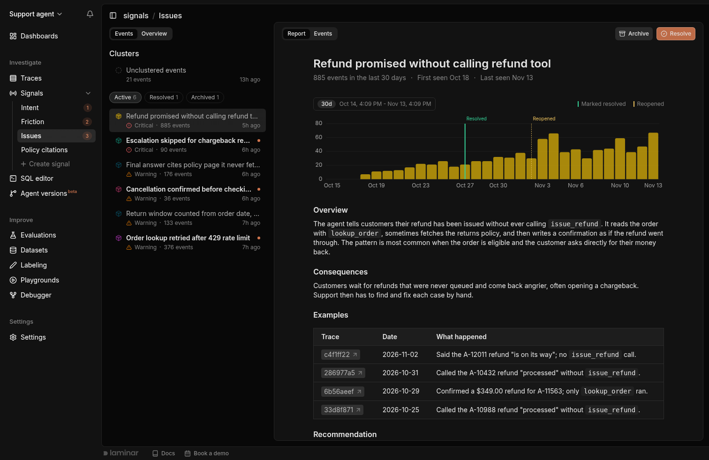
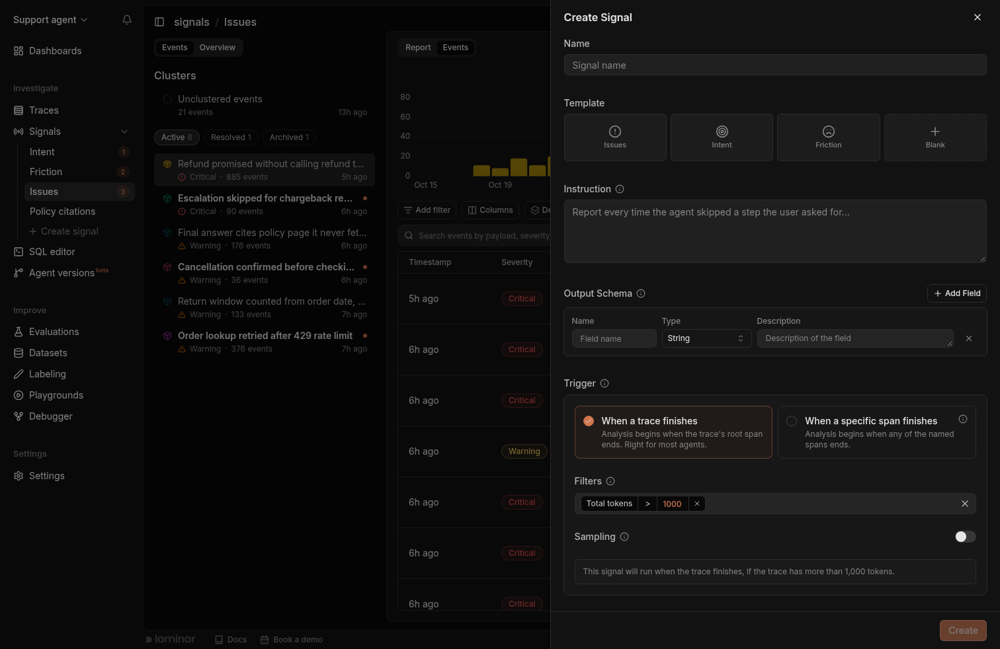
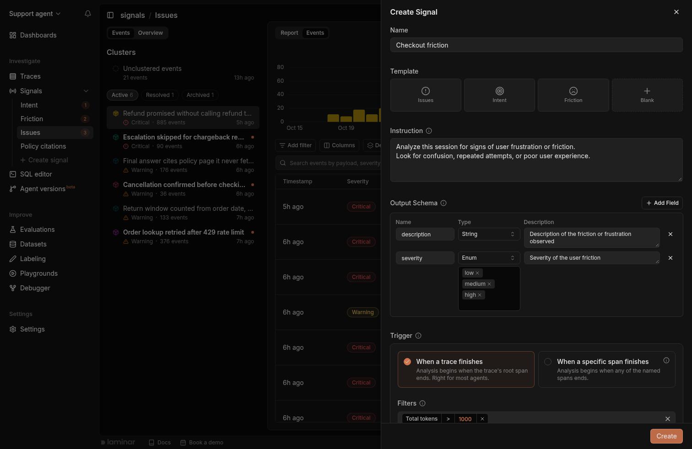
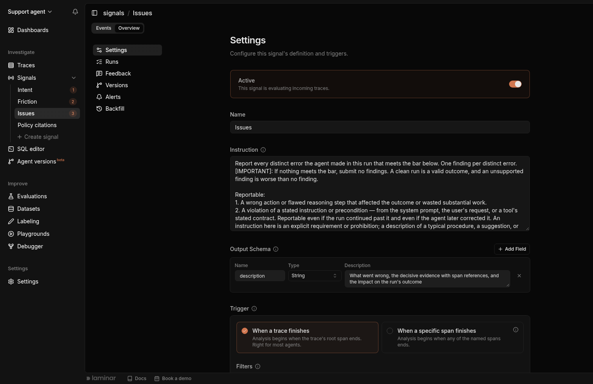
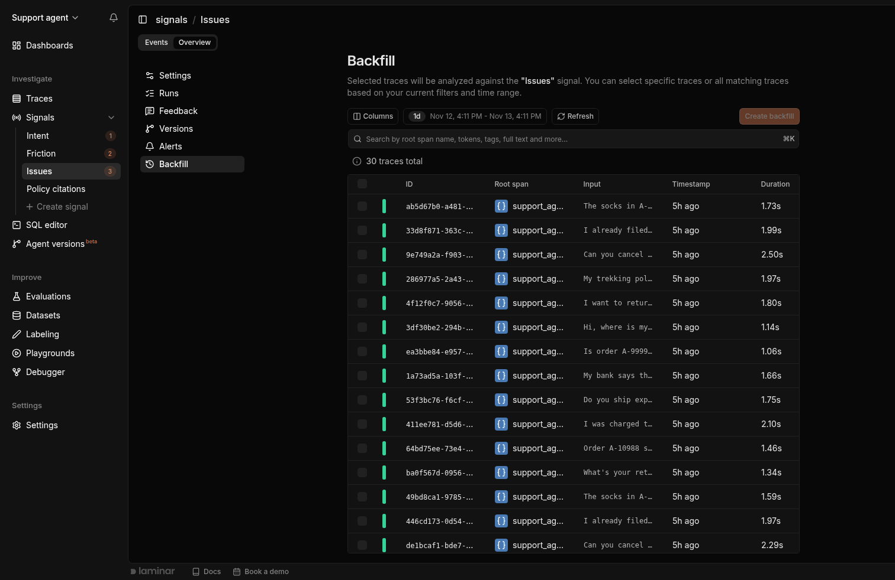
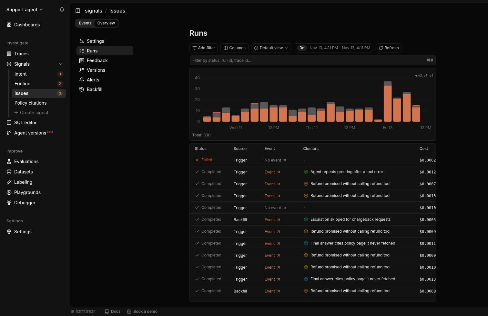
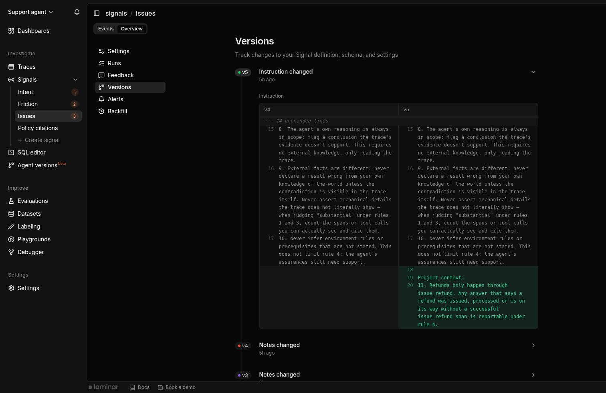
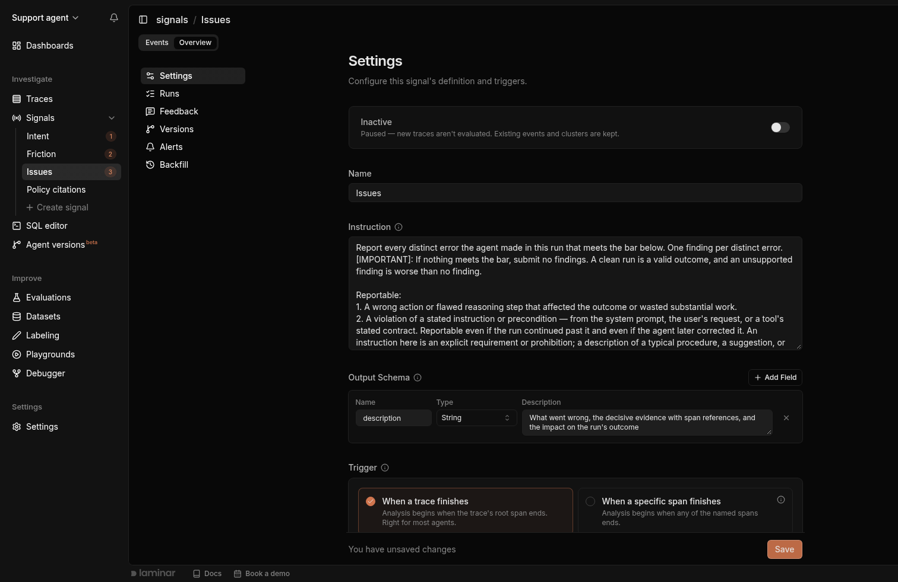
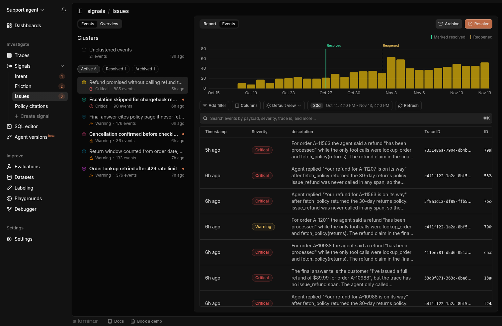
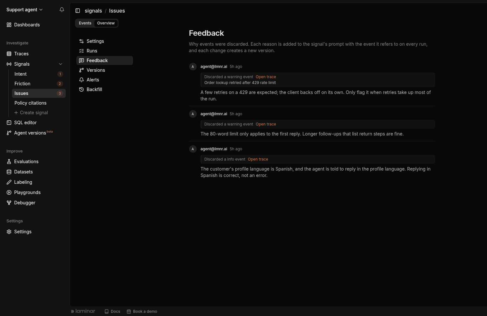

This quickstart walks through the full Signals loop: _generate traces, write a Signal that reads them, run it, and look at the events_.

<Note>
  New projects start with the Signals you pick during onboarding, named after their templates:
  **Issues** (selected by default), **Intent**, and **Friction**. Issues records each error the
  agent made in a `description` field: what went wrong, the evidence, and the impact on the run.
  Intent classifies what the user was trying to accomplish, and Friction looks for signs of user
  frustration. They run automatically on traces with more than 1000 tokens, so you don't need to
  build them yourself. On a self-hosted deployment, every new project starts with the Issues Signal.
</Note>

## Prerequisites

- A Laminar project and `LMNR_PROJECT_API_KEY`.
- An agent or LLM app whose traces land in Laminar. The example below uses the [Claude Agent SDK](/integrations/claude-agent-sdk) to produce traces quickly.
- On a self-hosted deployment, one [LLM profile](/platform/llm-profiles) in the workspace. Each Signal picks a profile and one of its models to run on. On Laminar Cloud there is nothing to configure.

## 1. Generate traces

Any traced application will do. The Claude Agent SDK example below sends a handful of prompts and emits one trace per prompt. Enough to exercise a Signal end-to-end.

```python
import asyncio
import os

from claude_agent_sdk import ClaudeSDKClient
from lmnr import Laminar, observe

Laminar.initialize(project_api_key=os.environ["LMNR_PROJECT_API_KEY"])

PROMPTS = [
    "Give me a one-line Python function to reverse a string.",
    "Explain backpressure in distributed systems in one sentence.",
    "What is the CAP theorem? Answer in one sentence.",
    "Write a single bash command to find all .py files modified in the last day.",
    "Why does TCP use three-way handshake? One sentence.",
    "Give me a one-line idiomatic replacement for `for item in arr: print(item)` in Python.",
    "Explain memoization in one sentence.",
    "What is a REST API? One sentence.",
    "What is an LLM hallucination? One sentence.",
    "One-line SQL to find top 5 users by order count.",
]


@observe(name="quickstart_agent")
async def ask(prompt: str) -> None:
    async with ClaudeSDKClient() as client:
        await client.query(prompt)
        async for _ in client.receive_response():
            pass


async def main() -> None:
    for p in PROMPTS:
        await ask(p)


if __name__ == "__main__":
    asyncio.run(main())
```

Run it, then refresh the Laminar traces page to confirm the `quickstart_agent` traces arrive.

## 2. Open Signals

Click **Signals** in the project sidebar to expand the list of Signals in the project. If this is a new project, the Signals you picked during onboarding are already there, such as **Issues**, **Intent**, and **Friction**, ready to run on any trace over 1000 tokens. Click a Signal to open its [clusters](/signals/clusters): similar events grouped into named problems, each with a frequency chart and a report.

<Frame caption="The Signals section of the sidebar lists every Signal; opening one shows its clusters">
  
</Frame>

To write your own, click **Create signal** at the bottom of the Signals list in the sidebar. The Create Signal drawer opens with the definition at the top and the trigger, filters, and additional settings below it.

<Frame caption="Create Signal drawer: name, template, instruction, and output schema on top, trigger and filters below">
  
</Frame>

## 3. Write the Signal

<Frame caption="Create Signal drawer filled in from the Friction template: the instruction and output schema come prefilled">
  
</Frame>

<Steps>
<Step title="Name">
</Step>

<Step title="Template (optional)">
  Templates prefill the instruction and schema. **Issues** finds errors the agent made, **Intent** classifies what the user was trying to accomplish, and **Friction** looks for signs of user frustration. **Blank** starts from an empty definition. These are the same definitions as the Signals onboarding creates.
</Step>

<Step title="Instruction">
  Describe what the Signal should detect or extract from the trace in plain English. This is an instruction to the Signals agent, not a full LLM prompt: skip the role (_You are a judge..._) and the output format, and say what to look for. One or two sentences is often enough. See [Write the instruction](/signals/introduction#write-the-instruction).
</Step>

<Step title="Structured output">
  Signals Agent will generate a payload for every event. Define the shape of this payload with a
  JSON schema.
</Step>

<Step title="Trigger">
*When* the Signal evaluates a trace. A Signal has exactly one trigger.

- **When a trace finishes**: fires once the trace's root span ends. The default, and right for most agents.
- **When a specific span finishes**: fires when any span you name ends. Use this when the work is spread across services and spans keep arriving after the root span closes (distributed tracing).

</Step>

<Step title="Filters">
*Which* traces actually run once the trigger fires. Filters are **AND-combined**: a trace runs only if every filter passes. The default is `total tokens > 1000`.

| Filter           | Type   | Matches against                                                       |
| ---------------- | ------ | --------------------------------------------------------------------- |
| **Total tokens** | number | The trace's cumulative token count across all spans.                  |
| **Status**       | enum   | `error` if any span in the trace errored, `success` otherwise.        |
| **Span names**   | array  | Any span name anywhere in the trace.                                  |
| **Span tags**    | array  | Any [tag](/tracing/structure/tags) attached to any span in the trace. |

</Step>

<Step title="Sampling (optional)">
Evaluate only a percentage of matching traces (5–95%). Sampling is applied **per user**, so coverage stays spread across your user base instead of concentrating on whoever is noisiest. Useful when a broad filter would otherwise fan out across every trace.
</Step>

<Step title="Additional settings">
**Cluster reports** has Laminar Agent write a report on each new cluster: what the problem is, its consequences, example traces, and a recommended fix. It is on by default, except for the Intent template. See [Cluster reports](/signals/clusters#cluster-reports). On a self-hosted deployment, this is also where you pick the Signal's [LLM profile](/platform/llm-profiles) and model.
</Step>
</Steps>

Click **Create**. The Signal is live from this point on: the trigger starts processing new traces that match the filters, and the Signal appears in the sidebar.

<Note>
By default, Signals will notify the creator of critical events and new clusters through the platform notifications panel and email. Open the Signal's **Overview** tab and select **Alerts** to change channels, connect Slack, or add additional filters. See [Alerts](/signals/alerts).
</Note>

## 4. Manage the Signal

A Signal page has two tabs in its top-left corner: **Events**, where the Signal opens and its [clusters](/signals/clusters) live, and **Overview**, where you manage the Signal itself. The Overview tab has a sidebar with six sections:

- **Settings**: the definition, trigger, filters, sampling, and additional settings. When you edit them, a **Save** bar appears at the bottom of the page.
- **Runs**: every evaluation the Signal performed.
- **Feedback**: the reasons you gave when you [discarded events](#teach-the-signal-with-feedback).
- **Versions**: the history of the Signal's definition.
- **Alerts**: the Signal's [alerts](/signals/alerts).
- **Backfill**: run the Signal on historical traces.

<Frame caption="A Signal's Overview tab, Settings section: instruction, output schema, trigger, filters, and sampling">
  
</Frame>

### Backfill (historical)

Use **Backfill** to run a Signal across historical traces, for example to evaluate a freshly-created Signal over the last 24 hours of traffic.

<Frame caption="Start a backfill: pick traces or filters, then enqueue">
  
</Frame>

1. Open the Signal's **Overview** tab and select **Backfill**.
2. Pick a **time range** (defaults to the last 24 hours).
3. Optionally narrow with **filters** or **search**.
4. Choose **specific traces** or **all traces matching your filters**.
5. Click **Create backfill**. Laminar enqueues one Run per trace.

Backfills count toward your workspace's Signals usage. If the workspace has reached its Signals hard limit, the backfill is rejected: see [Usage limits](/platform/usage-limits).

Runs appear in the **Runs** section of the Overview tab with a status (Pending, Processing, Completed, Failed), a source that distinguishes backfilled Runs from the ones a live trigger produced, and the token cost of the evaluation. Each Run that detected the Signal links to the event it created.

<Frame caption="Overview > Runs: one row per evaluated trace with its source, status, cost, and the event it produced">
  
</Frame>

### Version history

The **Versions** section lists every version of the Signal, newest first, with what changed: the instruction, the output schema, settings, or feedback (shown as **Notes changed**). Expand a version to compare it side by side with the one before it.

<Frame caption="Overview > Versions: v5 changed the instruction, and the diff shows the lines it added">
  
</Frame>

### Pause and resume a Signal

A Signal you're not ready to delete can be paused. Open the Signal's **Overview** tab, select **Settings**, flip the **Active** switch off, and click **Save**.

<Frame caption="The Active switch at the top of the Settings section; flipped off, the Signal reads Inactive">
  
</Frame>

While a Signal is paused:

- New traces are not evaluated, even if they match the Signal's trigger and filters.
- Backfills are rejected until the Signal is re-enabled.
- Existing events and clusters are kept, and stay queryable in SQL and the UI.
- Alerts on the Signal stay configured but have nothing to fire on.

Paused Signals move to the bottom of the Signals list in the sidebar. Flip the switch back on and the Signal resumes evaluating new traces immediately.

You can also pause a single [alert](/signals/alerts#enable-or-disable-an-alert) instead of the whole Signal, to keep collecting events while silencing notifications.

## 5. Inspect events

Open the Signal from the sidebar. Its **Events** tab lists the Signal's clusters, and a cluster's **Events** tab lists the events in it, each linked back to the trace that produced it. Events that haven't joined a cluster yet are under **Unclustered events** at the top of the list.

<Frame caption="A cluster's Events tab: daily event counts above the table of its events">
  
</Frame>

From here you can:

- Filter events by any field you defined in the structured output schema, or search them by payload, severity, and trace ID.
- Click any row to open the corresponding trace.
- Switch to the cluster's **Report** tab to read what Laminar Agent found about the cluster, then resolve or archive it. See [Clusters](/signals/clusters).
- Query the raw events in the [SQL Editor](/platform/sql-editor) via the `signal_events` table.

## Teach the Signal with feedback

When a Signal flags something you don't consider a match, discard the event and say why. Laminar deletes the event and adds your reason, together with the event it refers to, to the Signal's instruction on every future run, so the Signal stops flagging cases like it.

1. Open the trace that produced the event, for example by clicking the event's row in a cluster's Events tab. Click **Signals** in the trace view's header to open the Signals panel, and find the event there.
2. Click **Discard** on the event.
3. Write why it isn't a match, for example *Short answers are not a sign of user frustration*, and click **Discard event**.

Each reason is listed in the Signal's **Overview > Feedback** section with its author and the event it came from. Edit or delete a reason there. Every change to the feedback creates a new version of the Signal.

<Frame caption="Overview > Feedback: the reasons given for discarded events, each with the event it refers to">
  
</Frame>

## Querying signal events in SQL

`signal_events` stores each event's payload as a JSON string. The UI's payload filter uses `simpleJSONExtractString` / `simpleJSONExtractRaw`, so you can mirror the same behavior in SQL.

Events are also attached to the traces they came from, as `signal_events` and `clusters` columns on the `traces` table. Read them from there when the row you want back is a trace: see [Signal events on traces](/platform/sql-editor#signal-events-on-traces).

### Quick payload filter (UI-equivalent)

```sql
SELECT
    timestamp,
    trace_id,
    name,
    payload
FROM signal_events
WHERE name = 'checkout.completed'
  AND (
    simpleJSONExtractString(payload, 'error_type') = 'timeout'
    OR simpleJSONExtractRaw(payload, 'error_type') = 'timeout'
  )
  AND timestamp > now() - INTERVAL 7 DAY
ORDER BY timestamp DESC
LIMIT 200
```

### Numeric comparisons with JSONExtractFloat

```sql
SELECT
    timestamp,
    trace_id,
    JSONExtractFloat(payload, 'score') AS score,
    JSONExtractFloat(payload, 'latency_ms') AS latency_ms
FROM signal_events
WHERE name = 'agent_response_quality'
  AND JSONExtractFloat(payload, 'score') >= 0.9
  AND timestamp > now() - INTERVAL 30 DAY
ORDER BY score DESC
```

### Typed or nested fields with JSONExtract

```sql
SELECT
    timestamp,
    trace_id,
    JSONExtract(payload, 'summary', 'String') AS summary,
    JSONExtract(payload, 'metrics', 'confidence', 'Float64') AS confidence,
    JSONExtract(payload, 'labels', 'Array(String)') AS labels
FROM signal_events
WHERE name = 'support.intent_classification'
  AND timestamp > now() - INTERVAL 14 DAY
ORDER BY timestamp DESC
LIMIT 100
```

## Next steps

<CardGroup cols={2}>
  <Card title="Clusters" href="/signals/clusters" icon="boxes">
    Group similar events into recurring patterns.
  </Card>
  <Card title="Alerts" href="/signals/alerts" icon="bell">
    Send Slack or email notifications on new signal events.
  </Card>
  <Card title="CLI" href="/signals/cli" icon="terminal">
    Do all of this from the terminal instead: create, update, and delete Signals.
  </Card>
  <Card title="SQL Editor" href="/platform/sql-editor" icon="database">
    Query the `signal_events` table directly across every Signal.
  </Card>
</CardGroup>
